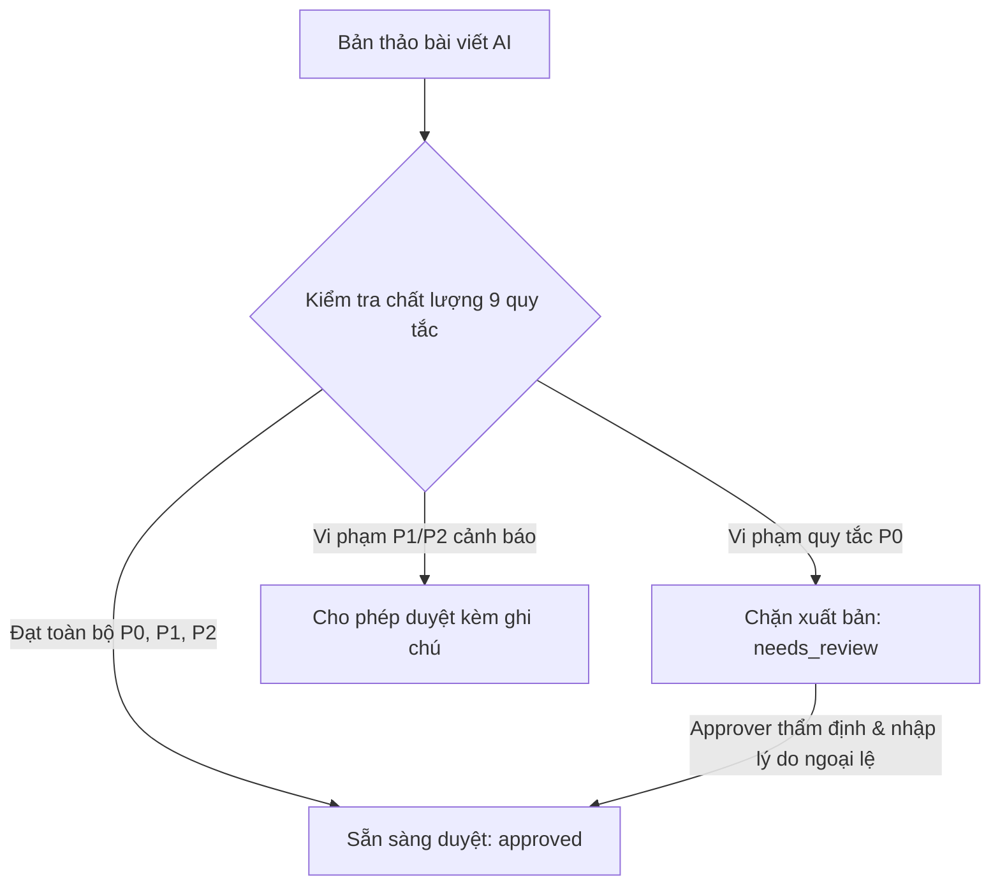

# TÀI LIỆU HƯỚNG DẪN VẬN HÀNH DÀNH CHO PHÒNG MARKETING & SEO
*Hệ thống: Phần mềm Auto SEO & Tự động xuất bản đa nền tảng (addp-autoseo)*
*Phiên bản: v1.2 (Bàn giao chính thức sau Pilot AC13)*
*Tác giả: Nhóm Kỹ thuật Dev1 - Dev2 | Ngày bàn giao: Tháng 11/2026*

---

## MỤC LỤC
1. [Giới thiệu tổng quan & Phân quyền người dùng](#1-giới-thiệu-tổng-quan--phân-quyền-người-dùng)
2. [Quản lý Website & Kết nối CMS (WordPress & Magento 2)](#2-quản-lý-website--kết-nối-cms-wordpress--magento-2)
3. [Nghiên cứu Từ khóa & Gom cụm chủ đề (Keywords & Content Plan)](#3-nghiên-cứu-từ-khóa--gom-cụm-chủ-đề-keywords--content-plan)
4. [Biên tập bài viết với AI & Bộ 9 quy tắc chất lượng SEO](#4-biên-tập-bài-viết-với-ai--bộ-9-quy-tắc-chất-lượng-seo)
5. [Quy trình Duyệt bài & So sánh phiên bản (ParagraphDiff)](#5-quy-trình-duyệt-bài--so-sánh-phiên-bản-paragraphdiff)
6. [Xếp lịch xuất bản & Tính năng "Đăng ngay" (Publish Now)](#6-xếp-lịch-xuất-bản--tính-năng-đăng-ngay-publish-now)
7. [Xử lý sự cố xuất bản & Cơ chế đối soát (needs_reconcile)](#7-xử-lý-sự-cố-xuất-bản--cơ-chế-đối-soát-needs_reconcile)
8. [Nút dừng khẩn cấp toàn hệ thống (Emergency Stop Kill Switch)](#8-nút-dừng-khẩn-cấp-toàn-hệ-thống-emergency-stop-kill-switch)
9. [Báo cáo & Giám sát chi phí sử dụng AI (Token & VNĐ)](#9-báo-cáo--giám-sát-chi-phí-sử-dụng-ai-token--vnđ)

---

## 1. GIỚI THIỆU TỔNG QUAN & PHÂN QUYỀN NGƯỜI DÙNG

Hệ thống **SEO Studio (addp-autoseo)** hỗ trợ tự động hóa toàn bộ vòng đời nội dung SEO: từ nghiên cứu từ khóa, gom cụm chủ đề, sinh bài viết bằng trí tuệ nhân tạo (LLM), kiểm định chất lượng theo thuật toán Google E-E-A-T, đến xếp lịch và tự động xuất bản lên các hệ thống website của công ty (WordPress và Magento 2).

### 👥 3 Vai trò người dùng trong hệ thống:

| Vai trò (Role) | Đối tượng sử dụng | Quyền hạn chính |
| :--- | :--- | :--- |
| **Writer (Biên tập viên)** | Nhân viên Content, CTV viết bài | - Nhập từ khóa, xem báo cáo SEO Audit. - Tạo bản thảo bài viết, yêu cầu AI sinh bài theo dàn ý. - Chỉnh sửa nội dung, gửi yêu cầu duyệt bài (`needs_review`). - *Không thể tự duyệt bài xuất bản.* |
| **Approver (Trưởng nhóm nội dung)** | SEO Lead, Content Manager | - Toàn bộ quyền của Writer. - Xem báo cáo chất lượng 9 tiêu chí của mọi bản thảo. - Phê duyệt (`approved`), từ chối hoặc trả về sửa đổi. - Duyệt bài có ngoại lệ vi phạm P0 (bắt buộc nhập lý do bằng văn bản). - Xếp lịch xuất bản và bấm nút **"Đăng ngay"**. - Xem báo cáo chi phí token và đối soát lỗi xuất bản. |
| **Admin (Quản trị viên hệ thống)** | IT Admin, Giám đốc Marketing | - Toàn bộ quyền của Approver. - Thêm mới, chỉnh sửa, kiểm tra kết nối Website (WordPress, Magento 2). - Kích hoạt / Hủy bỏ **Nút dừng khẩn cấp (Emergency Stop)**. - Cấu hình hạn mức ngân sách AI hàng tháng. - Quản lý tài khoản và phân quyền nhân sự. |

---

## 2. QUẢN LÝ WEBSITE & KẾT NỐI CMS (WORDPRESS & MAGENTO 2)

Truy cập: **Menu Quản trị > Cài đặt > Website kết nối** (`/admin/websites`).

### 2.1. Kết nối Website WordPress:
1. Đăng nhập vào trang quản trị WordPress của website đích (ví dụ: `https://ahtrabi.com/wp-admin/`).
2. Vào **Thành viên > Hồ sơ của bạn** (Users > Profile).
3. Cuộn xuống mục **Mật khẩu ứng dụng (Application Passwords)**.
4. Nhập tên ứng dụng (ví dụ: `AutoSeoApp`) và bấm **Thêm mật khẩu ứng dụng mới**.
5. Sao chép chuỗi mật khẩu 24 ký tự dạng: `xxxx xxxx xxxx xxxx xxxx xxxx`.
6. Tại giao diện **SEO Studio**, bấm **Tạo mới Website**:
   - **Tên website:** Tên gợi nhớ (ví dụ: `AH-TRABI Tin Tức`).
   - **Loại CMS:** Chọn `WordPress`.
   - **Địa chỉ URL:** Nhập URL gốc kèm HTTPS (ví dụ: `https://ahtrabi.com/`).
   - **Tên đăng nhập:** Username tài khoản WordPress của bạn (ví dụ: `admin_trabi` - *Lưu ý: Không nhập tên của ứng dụng vào đây!*).
   - **Application Password:** Dán chuỗi mật khẩu 24 ký tự ở bước 5.
7. Bấm **Tạo**. Sau đó bấm nút **"Kiểm tra kết nối"** ở danh sách website. Trạng thái chuyển sang **Hoạt động (Xanh lục)** là đã kết nối thành công.

### 2.2. Kết nối Website Magento 2:
1. Đăng nhập vào Magento 2 Admin: **System > Extensions > Integrations**.
2. Bấm **Add New Integration**:
   - Điền tên: `AutoSeo Integration`.
   - Chuyển sang tab **API**: Cấp quyền `Custom` cho phân hệ Blog / CMS (`Company_BlogApi`).
3. Bấm **Save** rồi bấm **Activate**.
4. Magento sẽ hiển thị 4 mã xác thực: `Consumer Key`, `Consumer Secret`, `Access Token`, `Access Token Secret`.
5. Tại **SEO Studio**, tạo mới Website chọn CMS `Magento 2`, dán 4 mã xác thực trên và lưu.
6. Bấm **"Kiểm tra kết nối"** để xác nhận kết nối thành công.

> [!TIP]
> Toàn bộ mật khẩu và Access Token được mã hóa tự động bằng thuật toán bảo mật **AES-256** trước khi lưu vào cơ sở dữ liệu. Ngay cả quản trị viên cơ sở dữ liệu cũng không thể xem được dạng văn bản gốc.

---

## 3. NGHIÊN CỨU TỪ KHÓA & GOM CỤM CHỦ ĐỀ (KEYWORDS & CONTENT PLAN)

### 3.1. Nhập từ khóa (Keywords Page):
- Truy cập: **Khám phá > Từ khóa** (`/admin/keywords`).
- Bạn có thể thêm từng từ khóa thủ công hoặc bấm nút **"Nhập từ CSV"** để tải lên danh sách hàng trăm từ khóa từ Google Keyword Planner hoặc Ahrefs.
- Định dạng CSV chuẩn gồm 3 cột: `Keyword, Search Volume, Intent` (ví dụ: `máy dập viên nén, 1200, Commercial`).

### 3.2. Gom cụm chủ đề bằng AI (Topic Cluster):
- Chọn các từ khóa muốn gom cụm và bấm **"Gom cụm AI"**.
- Trí tuệ nhân tạo sẽ tự động phân tích ngữ nghĩa và nhóm các từ khóa liên quan thành một **Chủ đề chính (Pillar Content)** cùng các **Bài viết vệ tinh (Satellite Content)**, gán rõ Search Intent:
  - `Informational` (Tìm hiểu kiến thức).
  - `Commercial` (Cân nhắc giải pháp/sản phẩm).
  - `Transactional` (Sẵn sàng mua hàng/báo giá).

### 3.3. Lập kế hoạch nội dung tuần (Content Plan):
- Truy cập: **Khám phá > Kế hoạch nội dung** (`/admin/content-plan`).
- Kéo thả các cụm chủ đề vào lịch biểu từng ngày trong tuần.
- Hệ thống hỗ trợ thiết lập giới hạn xuất bản (Quota) tối đa mỗi ngày cho từng website đích để tránh bị công cụ tìm kiếm phạt vì xuất bản bài viết dồn dập bất thường.

---

## 4. BIÊN TẬP BÀI VIẾT VỚI AI & BỘ 9 QUY TẮC CHẤT LƯỢNG SEO

### 4.1. Quy trình sinh bài viết:
1. Từ Kế hoạch nội dung hoặc menu Bài viết, chọn **"Tạo bài viết mới"**.
2. Chọn từ khóa chính, website đích và dàn ý mong muốn.
3. Bấm **"Sinh bài viết bằng AI"**. Hệ thống kích hoạt mô hình ngôn ngữ lớn (Gemini 1.5 Flash / Pro) áp dụng bộ Prompt chuẩn v1.1.
4. AI trả về toàn bộ bài viết hoàn chỉnh gồm: Tiêu đề H1, nội dung HTML, SEO Title, Meta Description, danh sách câu hỏi FAQ Schema và trích dẫn nguồn kiểm chứng.

### 4.2. Bộ 9 quy tắc kiểm tra chất lượng SEO (SEO Quality Rubric):
Hệ thống tự động rà soát bài viết qua 9 quy tắc thuộc 3 cấp độ:

| Mã quy tắc | Tên tiêu chí | Cấp độ | Ngưỡng yêu cầu | Hướng khắc phục nếu vi phạm |
| :--- | :--- | :---: | :--- | :--- |
| **LEN01** | Độ dài bài viết | **P0** | $\ge 800$ từ tiếng Việt | Bổ sung phân tích chi tiết, giải thích thêm thông số kỹ thuật. |
| **HEAD01** | Cấu trúc đề mục | **P0** | $\ge 3$ thẻ H2, $\ge 2$ thẻ H3, **không có thẻ H1** trong thân bài | Chia nhỏ nội dung thành các mục H2/H3 rõ ràng; xóa thẻ H1 trùng lặp. |
| **KW01** | Mật độ từ khóa chính | **P0** | Từ $1.0\%$ đến $2.5\%$ | Nếu $< 1.0\%$: chèn thêm từ khóa tự nhiên. Nếu $> 2.5\%$: thay bằng từ đồng nghĩa. |
| **SAFE01** | Miễn trừ y tế | **P0** | Bắt buộc có khối miễn trừ y tế nếu là chủ đề Sức khỏe/Dược phẩm | Thêm khối `<blockquote>` thông báo miễn trừ trách nhiệm y khoa ở cuối bài. |
| **KW02** | Vị trí từ khóa | **P1** | Có trong H1, ít nhất 1 thẻ H2 và 100 từ đầu tiên | Đưa từ khóa vào mở đầu và tiêu đề phụ quan trọng nhất. |
| **META01** | Độ dài SEO Title | **P1** | $\le 60$ ký tự | Cắt bớt từ thừa, ưu tiên giữ từ khóa chính và tên website. |
| **META02** | Độ dài Meta Description | **P1** | Từ $130$ đến $155$ ký tự | Viết lại câu mô tả súc tích, đủ độ dài để hiển thị trọn vẹn trên Google. |
| **FACT01** | Nguồn kiểm chứng | **P1** | $\ge 2$ nguồn trích dẫn uy tín | Bổ sung tài liệu kiểm nghiệm, tiêu chuẩn ISO/GMP hoặc dược điển. |
| **FAQ01** | Cấu trúc câu hỏi FAQ | **P2** | $\ge 2$ cặp câu hỏi & câu trả lời | Thêm các câu hỏi người dùng hay thắc mắc vào mục FAQ. |

---

## 5. QUY TRÌNH DUYỆT BÀI & SO SÁNH PHIÊN BẢN (PARAGRAPHDIFF)

### 5.1. Quy trình trạng thái (Workflow Lifecycle):
$$\text{planned} \longrightarrow \text{drafting} \longrightarrow \text{needs\_review} \longrightarrow \text{approved} \longrightarrow \text{scheduled} \longrightarrow \text{publishing} \longrightarrow \text{published}$$

- **Bản thảo vi phạm tiêu chí P0:** Tự động chuyển sang trạng thái `needs_review` (Chờ xem xét).
- **Phê duyệt bài có ngoại lệ (Override P0):** Chỉ Approver hoặc Admin mới có quyền duyệt bài vi phạm P0. Khi bấm Duyệt ngoại lệ, hệ thống hiển thị hộp thoại bắt buộc nhập **"Lý do ngoại lệ P0"** (tối thiểu 10 ký tự, ví dụ: *"Bài viết dạng thông báo ngắn theo yêu cầu của Giám đốc"*). Lý do này được ghi nhận vĩnh viễn vào nhật ký kiểm toán hệ thống.

### 5.2. Công cụ so sánh phiên bản (ParagraphDiff):
- Khi biên tập viên hoặc AI chỉnh sửa một bài viết, một phiên bản mới (`ArticleVersion`) sẽ được tạo ra tự động.
- Vào chi tiết phiên bản, hệ thống cung cấp công cụ so sánh trực quan:
  - <mark style="background-color: #d1fae5; color: #065f46;">Đoạn văn bản màu xanh lá:</mark> Nội dung mới được thêm vào.
  - <del style="color: #dc2626; background-color: #fee2e2;">Đoạn văn bản màu đỏ gạch ngang:</del> Nội dung cũ bị xóa đi.
- Giúp Trưởng nhóm nhanh chóng nhận diện thay đổi mà không cần đọc lại toàn bộ bài viết từ đầu.

---

## 6. XẾP LỊCH XUẤT BẢN & TÍNH NĂNG "ĐĂNG NGAY" (PUBLISH NOW)

### 6.1. Xếp lịch đăng tự động:
- Sau khi bài viết đạt trạng thái `approved`, Approver bấm **"Lên lịch xuất bản"**.
- Chọn Website đích và Ngày giờ đăng (hệ thống tự động quy đổi múi giờ chuẩn Việt Nam `Asia/Ho_Chi_Minh` sang UTC để xử lý hàng đợi).
- Trạng thái chuyển sang `scheduled`. Khi tới giờ hẹn, hàng đợi tự động đẩy bài lên website đích.

### 6.2. Tính năng "Đăng ngay" (Publish Now) khi có bài khẩn cấp:
- Trong trường hợp bài viết tin tức nóng hoặc khuyến mãi cần xuất bản ngay lập tức:
  1. Vào danh sách Lịch xuất bản (`/admin/publications`).
  2. Bấm vào bài viết đã được phê duyệt.
  3. Bấm nút màu tím nổi bật **"Đăng ngay" (Publish Now)**.
  4. Hệ thống hiển thị hộp thoại xác nhận: *"Bạn có chắc chắn muốn xuất bản bài viết này lên website đích ngay lập tức không?"*.
  5. Bấm **Xác nhận**. Hệ thống lập tức gọi API đến WordPress hoặc Magento 2 trong vòng vài giây, bài viết chuyển sang trạng thái `published` và hiển thị thông báo kèm **đường link bài viết thật** để kiểm tra ngay.

---

## 7. XỬ LÝ SỰ CỐ XUẤT BẢN & CƠ CHẾ ĐỐI SOÁT (NEEDS_RECONCILE)

### 7.1. Cơ chế chống đăng trùng lặp (Idempotency Key):
Mỗi lần xuất bản đều đi kèm một mã định danh duy nhất gọi là `publication_key` (ví dụ: `wp-site3-art14-v1`). Website đích ghi nhận khóa này để bảo đảm dù gửi yêu cầu bao nhiêu lần thì trên website vẫn **chỉ xuất hiện duy nhất 1 bài viết**.

### 7.2. Xử lý khi gặp lỗi mạng hoặc Timeout 504:
- Khi hệ thống gửi bài sang website đối tác nhưng kết nối mạng bị ngắt quãng hoặc máy chủ web phản hồi chậm (HTTP 504 Gateway Timeout):
- **Hệ thống TUYỆT ĐỐI KHÔNG tự động bấm đăng lại** (vì nếu website đã kịp lưu bài, việc đăng lại sẽ gây ra bài viết trùng lặp trên Google, làm giảm thứ hạng SEO).
- Lượt xuất bản sẽ chuyển sang trạng thái **`needs_reconcile` (Cần đối soát)**.
- **Cách xử lý dành cho Marketing:**
  1. Vào danh sách Xuất bản, lọc trạng thái `needs_reconcile`.
  2. Bấm nút **"Đối soát xuất bản"**.
  3. Hệ thống sẽ tự động tra cứu trên website đích theo `publication_key`:
     - Nếu bài đã tồn tại trên website: Hệ thống cập nhật link bài viết thật và chuyển sang `published`.
     - Nếu bài thực sự chưa được tạo: Hệ thống chuyển sang `failed` và cho phép bấm thử lại an toàn.

---

## 8. NÚT DỪNG KHẨN CẤP TOÀN HỆ THỐNG (EMERGENCY STOP KILL SWITCH)

### 8.1. Khi nào cần kích hoạt?
Khi phát hiện sự cố nghiêm trọng như:
- Tin tức sai lệch chính sách cần rà soát lại toàn bộ.
- Website công ty đang bị tấn công DDoS hoặc bảo trì đột xuất.
- AI sinh nhầm thông tin giá cả hoặc khuyến mãi.

### 8.2. Cách thức hoạt động:
- **Kích hoạt:** Admin vào trang quản trị bấm **"Kích hoạt Dừng khẩn cấp"**.
- Ngay lập tức:
  - Một biểu ngữ cảnh báo màu đỏ đậm xuất hiện ở đầu trang: **"HỆ THỐNG ĐANG DỪNG XUẤT BẢN KHẨN CẤP"**.
  - Toàn bộ các bài viết đang chờ trong hàng đợi xuất bản tự động đều bị tạm hoãn ngay lập tức.
  - Không một bài viết nào có thể bắn sang WordPress hay Magento cho đến khi nút dừng được tắt bỏ.
- **Hủy kích hoạt:** Sau khi sự cố đã được xử lý xong, Admin bấm **"Hủy dừng khẩn cấp"**. Hệ thống tiếp tục vận hành bình thường theo đúng kế hoạch.

---

## 9. BÁO CÁO & GIÁM SÁT CHI PHÍ SỬ DỤNG AI (TOKEN & VNĐ)

Hệ thống ghi nhận minh bạch từng đồng chi phí sử dụng trí tuệ nhân tạo:
- Truy cập: **Cài đặt > Chi phí AI** (`/admin/ai-costs`).
- **Thông tin theo dõi chi tiết:**
  - Tổng số Token đầu vào (Prompt Tokens) và Token hoàn thành (Completion Tokens).
  - Tên mô hình sử dụng (Gemini 1.5 Flash hoặc Gemini 1.5 Pro).
  - Quy đổi tự động sang đồng Việt Nam (VNĐ) theo tỷ giá thời gian thực.
- **Chi phí trung bình thực tế:**
  - Với mô hình Gemini 1.5 Flash: **Chưa tới 50 VNĐ cho một bài viết 1000 từ hoàn chỉnh**.
  - Ngân sách 1 tháng cho 500 bài viết xuất bản liên tục chỉ khoảng ~25.000 VNĐ, tiết kiệm hơn 99% so với thuê nhân sự viết bài thủ công truyền thống.
- **Cảnh báo hạn mức ngân sách:** Khi chi phí đạt 80% ngân sách tháng do Admin cài đặt, hệ thống sẽ gửi thông báo cảnh báo để lãnh đạo chủ động điều chỉnh.

---
*Tài liệu được soạn thảo và kiểm thử tương thích 100% với phiên bản phần mềm V1.2. Mọi thắc mắc kỹ thuật xin vui lòng liên hệ nhóm phát triển IT nội bộ.*
