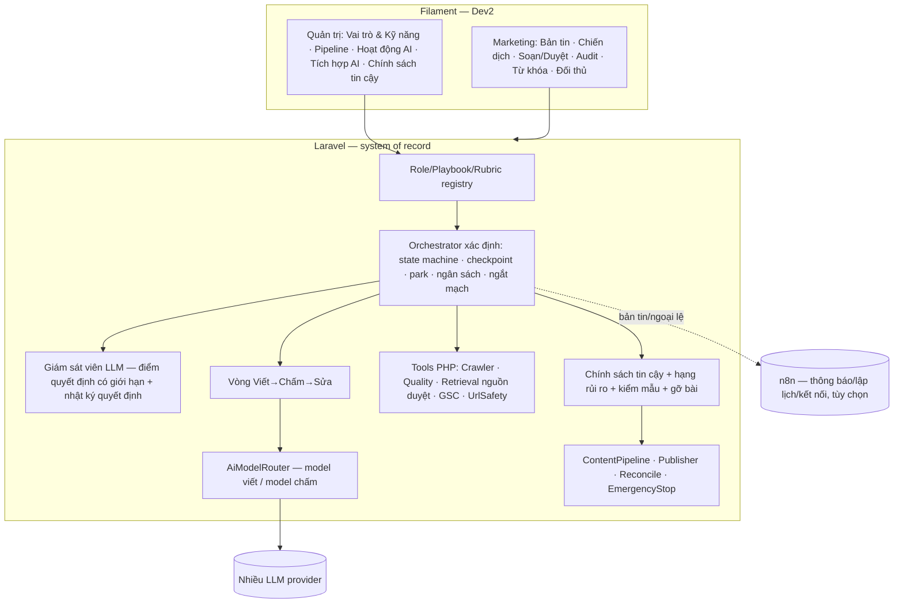

# THIẾT KẾ — ĐỘI AI SEO TỰ ĐỘNG (HỌC TỪ `claude-seo`), NGƯỜI CÓ CŨNG ĐƯỢC, KHÔNG CÓ CŨNG XONG

> Bản 1/2 · **v0.3** · 07/11/2026 · Viết lại theo ưu tiên: **tự động hóa là mặc định; con người là tùy chọn** (quan sát, ghi đè khi muốn), không phải điều kiện để hệ thống chạy tiếp.
> Đi kèm `AI_AUTOMATION_EXECUTION_PLAN.md` v0.3 và mẫu `mockups/auto-seo-ui-preview.html`. Kế thừa kiến trúc/UX roadmap/kịch bản S01–S46.
> **Chỉ phân tích/đề xuất. Chưa sửa code, chưa sửa `TASKS.md`.**

### Giả định tôi đã đặt (bạn đổi được)
| # | Giả định | Vì sao |
|---|---|---|
| G1 | Chấp nhận **thang tin cậy** cho xuất bản (T0 nháp nội bộ → T1 đẩy CMS dạng *nháp* → T2 tự đăng nhóm rủi ro thấp + kiểm mẫu + tự gỡ → T3 mở rộng). **Mặc định T1** trong M09 | Bạn nói "làm như bạn đề xuất" |
| G2 | **Đường mỏng đầu tiên** chạy trên **một website WordPress (blog)**, nội dung thông tin | WordPress connector (1.2) đã có; mục tiêu V1.0 gốc cũng là "đăng nháp WordPress" |
| G3 | **Lõi điều phối nằm trong Laravel** (state machine + job); n8n (nếu dùng) làm thông báo/kết nối/lập lịch | Vòng lặp tự sửa cần trạng thái và checkpoint nhất quán |
| G4 | Chính sách tự đăng (T2+) cần **quyết định bằng văn bản** của bạn trước khi bật (`AGENTS.md` §1.4 và task 3.6) | Quy tắc dự án, tôi không tự coi là đã bỏ |

---

## 0. Bằng chứng và giới hạn
| Đã đọc thật | Chưa làm |
|---|---|
| **claude-seo v2.5.0:** `ARCHITECTURE`, skill `seo`, `seo-audit/technical/page/content/content-brief/cluster/sxo/plan/drift/flow`, `quality-gates.md`, `eeat-framework.md`, `agents/seo-technical.md`, `PRIVACY/SECURITY`, `url_safety.py` | **Chưa chạy** claude-seo; chưa đọc kỹ `geo/agentic/local/maps/backlinks/ecommerce/hreflang/programmatic/google/images/schema/sitemap`, extension |
| **Repo (`origin/develop` @ `7e9c2c0`):** `ContentQualityChecker` + 9 rule, `ContentPipelineService` (1 lượt), `GeminiAiProvider` (có fallback sang Mock), crawler 1.1, `EmergencyStopService`, autopublish 3.6, WordPress/Magento connector, seam `Support/*` | Chưa chạy test/CI; chưa thử vòng lặp tự sửa với model thật; chưa kiểm tra khả năng **gỡ bài** của connector; chưa thử chất lượng tiếng Việt |
Nhiều "quy tắc SEO" từ claude-seo là khẳng định của tác giả repo đó — **mỗi quy tắc phải xác minh với tài liệu Google chính thức** trước khi vào rubric (§4).

---

## 1. Mục tiêu và điều chỉnh
1. Học tri thức của `claude-seo` → **vai trò AI riêng** trong hệ thống của bạn (Laravel + Filament), nhiều model, có **bộ điều phối**.
2. **Tự động hoàn tất**: hệ thống tự phát hiện lỗi, tự tìm thêm (trong nguồn cho phép), tự sửa, tự đi tiếp. Người **có thể** xem/can thiệp, **không bắt buộc**.
3. Dev2 dẫn trước, giao diện dùng được thật; **cải thiện, không đập đi xây lại**.

| v0.2 | v0.3 |
|---|---|
| Mặc định "tự động có cổng"; `needs_input` làm run đứng chờ; giao diện xoay quanh hộp "Cần bạn" | **Mặc định tự động**; cổng là **cổng tự động bằng code**; chờ người thì **đỗ việc, làm việc khác**, hết hạn thì chạy **hành động mặc định an toàn** |
| Thứ tự "Học → Hiển thị → Điều khiển" | **Đường mỏng chạy hết từ đầu đến cuối trước**, rồi đào sâu |
| Không có vòng tự sửa | **Vòng Viết → Chấm → Sửa** có giới hạn + bảng **tự phục hồi lỗi** |
| Ngân sách ở lát cuối | Ngân sách/ngắt mạch/nhật ký run **ở lát đầu** |
| Chưa nói rõ cách xuất bản tự động | **Thang tin cậy + phân lớp rủi ro + kiểm mẫu + tự gỡ** |
| Giao diện "Cần bạn" | **Bản tin hằng ngày** + ngoại lệ tùy chọn |

**Không đổi (`AGENTS.md`):** AI trả dữ liệu có cấu trúc; nội dung crawl là *dữ liệu không đáng tin*; secret mã hóa; xuất bản qua Laravel, idempotent (`publication_key`), timeout → `needs_reconcile` (không retry mù); không bịa bằng chứng.
**⚠ Phạm vi:** n8n/tự động hóa lớn là **ngoài WBS 432h** (kế hoạch gốc ghi n8n tùy chọn V2, cần xét giấy phép) → mã `AG-*` riêng, chưa estimate chính thức, không cộng vào 432h.

---

## 2. claude-seo thực chất là gì (để biết học gì)
**Ngân hàng tri thức SEO có cấu trúc đóng gói thành prompt cho Claude Code + lớp script mỏng.** Giá trị nằm ở *cách làm* và *quy tắc*, không ở việc chạy nó.

| Loại tri thức | Ví dụ thật | Dùng cho |
|---|---|---|
| Rubric/ngưỡng | `quality-gates` (số từ, title/meta); `cwv-thresholds`; E-E-A-T có trọng số; trọng số điểm audit (Tech 22, Content 23, On-page 20, Schema 10, Perf 10, AI 10, Images 5) | Rubric dữ liệu |
| Phương pháp | Gom cụm trùng SERP (7–10/4–6/2–3/0–1); điểm khoảng trống = Tác động×Lợi thế/Công sức; page-type mismatch; drift 17 quy tắc; PERCEIVE→ANALYZE→VALIDATE→ACT | Playbook |
| Guardrail | Website Relevance Rule; Site Structure Coverage; ngưỡng cảnh báo 30/dừng 50 trang địa phương; **"nội dung AI hàng loạt" = rủi ro phạt**; metadata rập khuôn | Rào chắn cho tự động hóa |
| Định dạng đầu ra | `audit-data.json`; mỗi khuyến nghị có cơ sở/phụ thuộc/**cách kiểm chứng** | `ReportEnvelope` |
| Công cụ xác định | `scripts/*.py` | Ta có tương đương PHP; dùng làm đối chiếu |
| Dữ liệu có hạn dùng | `google-updates.json`, "currency-checked" | Rubric có `reviewed_at` |

**Không nhúng:** agent mẫu có `Bash/Write`; gắn model `opus/sonnet` (khóa một hãng); điều phối bằng phiên Claude Code (không có run/ngân sách/chính sách); đầu ra là file; runtime Python+Chromium nặng.

---

## 3. Bản đồ học: skill → vai trò
| Vai trò (của bạn) | Học từ | Hiện có (mở rộng, không viết lại) | Học cụ thể |
|---|---|---|---|
| **Quản lý SEO (điều phối)** | `seo` | — | Quy trình tổng hợp; mỗi hành động có cơ sở/phụ thuộc/cách kiểm chứng |
| **Chuyên viên Audit** | `seo-audit/technical/page/schema/sitemap` | Crawler 1.1 (12 mã lỗi, điểm=100−phạt), `OnPageAnalyzer`, `IssueCatalog` | Nhóm kiểm tra, mức nghiêm trọng, **một** thang điểm có tên |
| **Nghiên cứu từ khóa** | `seo-cluster` | `KeywordsPage`, `MockClusterer`, CSV | Intent 4 loại; ngưỡng trùng SERP; **bản giảm cấp** khi chưa có SERP |
| **Phân tích đối thủ** | `seo-sxo`, `seo-content-brief` §SERP | `CompetitorsPage`, `GapCalculator`, `CostPolicy` | Chấm khoảng trống; loại tên miền không phải đối thủ |
| **Chiến lược nội dung** | `seo-plan`, `seo-content-brief` | `ContentPlanPage`, `ContentBrief` | Website Relevance Rule; lộ trình 4 pha cho SME VN |
| **Biên tập / QA** | `seo-content`, `quality-gates` | **`ContentQualityChecker` + 9 rule + `QualityThresholds`** | Ngưỡng có nguồn; rule mới; rào chắn nội dung AI hàng loạt |
| **Giám sát hiệu suất** | `seo-drift`, `seo-google` | GSC UI (demo); 5.1 chưa làm | Baseline→so sánh→CRITICAL/WARNING/INFO |
| *Không học lúc này* | local, maps, ecommerce, backlinks, geo, agentic, hreflang, programmatic | — | Ngoài phạm vi blog/website công ty; chưa đọc kỹ |

---

## 3A. **TỰ ĐỘNG HÓA LÀ MẶC ĐỊNH** (phần mới, cốt lõi của v0.3)

### 3A.1 Mười nguyên tắc
| # | Nguyên tắc | Nghĩa là |
|---|---|---|
| A1 | **Mặc định chạy**, không chờ người | Giai đoạn nào đủ điều kiện thì chạy. Người quan sát và **có thể** ghi đè |
| A2 | **Cổng = cổng tự động bằng code** | Điều kiện: điểm rubric ≥ ngưỡng, guardrail, hạng rủi ro, ngân sách. Người chỉ xuất hiện khi chính sách *bắt buộc* |
| A3 | **Chờ người ≠ đứng yên** | Việc cần người được **đỗ** (parked) có hạn chờ; hệ thống làm việc khác; hết hạn → hành động mặc định an toàn (giữ nháp / bỏ claim / bỏ qua bước) |
| A4 | **Tự sửa có giới hạn** | Viết → Chấm (code + model chấm khác) → Sửa → Chấm lại; tối đa N vòng; mỗi vòng phải **cải thiện điểm**, không thì dừng vòng (chống quẩn) |
| A5 | **Tự phục hồi hạ tầng** | Bảng lỗi → hành động (§3A.3) |
| A6 | **Tìm thêm chỉ trong nguồn được duyệt** | Kho tri thức doanh nghiệp, trang của chính website (`crawled_urls`), CSV/GSC, danh sách nguồn cho phép. **Không web mở** trong M09; nội dung nguồn là dữ liệu không đáng tin |
| A7 | **Thang tin cậy cho xuất bản** | §3A.4 |
| A8 | **Hạng rủi ro chủ đề** | Thấp/vừa/cao (YMYL, giá, pháp lý, sức khỏe, tài chính…). Chỉ hạng **thấp** được tự đăng; hạng **cao** luôn giữ nháp + báo |
| A9 | **Ngân sách và ngắt mạch** | Trần theo run/ngày/chiến dịch/website; ngắt khi tỉ lệ lỗi/chi phí bất thường; kèm `EmergencyStop` (xuất bản) và dừng pipeline |
| A10 | **Quan sát thay cho duyệt** | Bản tin hằng ngày, cảnh báo ngoại lệ, nhật ký quyết định, kiểm mẫu sau đăng, nút huỷ/gỡ/ghi đè |

### 3A.2 "Người điều phối" là ai
- **Lõi xác định** (code Laravel): state machine theo `PipelineDefinition`, checkpoint/resume, retry, park, ngân sách, ngắt mạch. Không để LLM giữ luồng (LLM dễ lặp/hoang tưởng ở chuỗi dài).
- **Giám sát viên (Quản lý SEO) = LLM ở điểm quyết định có giới hạn**: "thử lại hay đổi cách?", "bỏ claim hay đỗ?", "báo ngoại lệ?", với **ngân sách riêng**; mọi quyết định ghi vào **nhật ký quyết định** (lý do + dữ kiện).
- Làm theo thứ tự: lõi xác định trước (Lát 1), giám sát viên LLM sau (Lát 3).

### 3A.3 Bảng tự phục hồi (lỗi → hành động tự động → khi nào đỗ/báo)
| Tình huống | Tự động làm gì | Khi nào đỗ/báo |
|---|---|---|
| Provider timeout/5xx | Retry có backoff (N) → chuyển model dự phòng **thật** | Hết N → run `failed` + báo |
| JSON/schema sai | Prompt "sửa định dạng" 1–2 lần → model khác | Vẫn sai → `failed`. **Không dùng Mock thay thế** |
| Bài không đạt rubric | **Vòng sửa** theo phản hồi có cấu trúc từ rubric | Hết N vòng hoặc điểm không tăng → **giữ nháp** + báo |
| Claim thiếu nguồn | Tìm trong nguồn được duyệt → nếu không có: **bỏ/viết lại không số liệu**, ghi claim đã bỏ | Claim nhạy cảm không thể bỏ → giữ nháp |
| Thiếu dữ liệu (đối thủ, từ khóa) | Thử nguồn kế tiếp → **bản giảm cấp có nhãn giới hạn** | Vẫn thiếu: bỏ bước phụ thuộc, đi tiếp việc khác, báo |
| Crawl timeout/bị chặn | Giảm phạm vi/URL khác | Báo giới hạn |
| CMS timeout sau khi gửi | `needs_reconcile` → đối soát theo `publication_key` | **Không retry mù** |
| CMS lỗi xác thực | **Ngắt mạch site đó** | Báo; không thử lặp |
| Vượt ngân sách | Dừng phần chưa chạy, giữ phần xong | Báo |
| Trùng từ khóa/cannibalization | Tự gộp hoặc đổi góc theo luật, ghi lý do | — |
| Nguồn chứa chỉ dẫn lạ | Bỏ nguồn đó, ghi nhật ký | — |

### 3A.4 Thang tin cậy xuất bản
| Bậc | Hành vi | Điều kiện lên bậc (số liệu, ví dụ) |
|---|---|---|
| **T0** | Chỉ nháp nội bộ | — |
| **T1 (mặc định M09)** | Tự đẩy vào **CMS dạng nháp** (khớp mục tiêu V1.0 gốc); người đăng sau | Tỉ lệ qua rubric ≥ ngưỡng; tỉ lệ tự sửa thành công; 0 sự cố bảo mật |
| **T2** | **Tự đăng** nhóm rủi ro thấp; **kiểm mẫu sau đăng**; **tự gỡ** khi phát hiện lỗi | Đủ số bài ở T1 với tỉ lệ lỗi < ngưỡng; `AG-K09` đạt; **có chính sách bằng văn bản** (G4); connector có **gỡ/rollback** |
| **T3** | Mở rộng nhóm rủi ro/nhịp đăng | Dựa kết quả GSC (cần 5.1) và kiểm mẫu |
Quy tắc: tự **giảm bậc** khi tỉ lệ lỗi/gỡ bài vượt ngưỡng. Nâng bậc là **quyết định của bạn**, hệ thống chỉ báo "đủ điều kiện".

### 3A.5 Điều tự động hóa KHÔNG nên làm lúc này (thành thật)
- Tự đăng nhóm rủi ro cao; tự đăng khi chưa có chính sách bằng văn bản; tự tìm trên web mở; tự mở rộng domain được phép; tự đổi credential; tự kết luận nhân quả SEO từ vài số liệu.

### 3A.6 Chỉ số mức tự động (để biết khi nào nâng bậc)
Tỉ lệ run hoàn tất không cần người · tỉ lệ tự sửa thành công · số vòng sửa trung bình · tỉ lệ đỗ/ngoại lệ · chi phí/bài · lỗi phát hiện khi kiểm mẫu · số lần gỡ bài · thời gian từ chọn chủ đề đến nháp CMS.

---

## 4. Điều học được áp dụng vào repo (cần xác minh nguồn)
| # | Hiện tại | claude-seo nói | Gợi ý | Xác minh |
|---|---|---|---|---|
| L1 | `MAX_KEYWORD_DENSITY_PERCENT=3.0` (KW01) | Không có mật độ mục tiêu; lặp tự nhiên mới là vấn đề | Chuyển sang cảnh báo nhồi từ khóa | Tài liệu Google |
| L2 | `MIN_WORDS=800` | Sàn bao phủ, không phải mục tiêu; blog 1.500 (tiếng Anh) | Giữ heuristic + ghi nguồn/lý do; hiệu chỉnh tiếng Việt | Dữ liệu thật |
| L3 | `FaqRule`, `faq_schema` | FAQ rich result ngừng (05/2026), HowTo lỗi thời | Rà lại; không ép FAQ | Search Central |
| L4 | Meta 120–160, title ≤60 | Title 50–60, meta 150–160; **meta rập khuôn** | Thêm rule metadata rập khuôn | Nội bộ + thử |
| L5 | Không rào chắn tự động hóa | AI hàng loạt = rủi ro phạt; Who/How/Why | Guardrail: giới hạn bài/ngày/site, nguồn/thông tin riêng bắt buộc | Quy định Google |
| L6 | Không có Website Relevance Rule | Chỉ gợi ý điều website làm được | Thêm vào Brief/Chiến lược | Nội bộ |
| L7 | Điểm audit = TB điểm URL | Điểm theo danh mục có trọng số | Luôn ghi `score_method` | Nội bộ |
| L8 | — | Flesch (tiếng Anh) | **Không** dùng cho tiếng Việt | Thử |
| L9 | Rubric là hằng số PHP, "chưa hiệu chỉnh" | Tri thức có ngày rà soát | Rubric dữ liệu + `nguồn/lý do/reviewed_at` | — |

---

## 5. Mô hình Playbook (giữ từ v0.2, thêm phần tự động)
- **Vai trò** (mục tiêu, vào/ra, công cụ, bậc model) · **Playbook** (bước, mẫu prompt, tham chiếu rubric) · **Rubric** (luật có ngưỡng — dữ liệu) · **Guardrail** (cấm cứng) · **Tool** (dịch vụ PHP/API, kiểm quyền phía server) · **Lineage** (học từ skill nào/MIT/chỉnh gì) · **Eval** (bộ mẫu tiếng Việt).
- Lưu trong repo `resources/playbooks/<role>/*.v<N>.*`; run ghi `playbook@version`, `rubric_version`. Playbook chưa qua bộ mẫu **không** được bật tự động.
- **Bổ sung cho tự động hóa:** mỗi playbook khai báo **(a)** điều kiện đạt (cổng tự động), **(b)** hành động sửa khi không đạt (phản hồi có cấu trúc cho vòng sửa), **(c)** hạng rủi ro áp dụng, **(d)** hành động mặc định khi hết hạn chờ.
- **Cách một lần chạy:** nạp playbook+rubric+hồ sơ doanh nghiệp+dữ liệu thật → `AiModelRouter` (model *viết*) → đầu ra có cấu trúc → rubric/guardrail kiểm bằng **code** + **model chấm khác** → vòng sửa → cổng tự động → ghi run/nhật ký quyết định.

---

## 6. Kiến trúc đích

Quy tắc: LLM chỉ qua router; rubric/guardrail kiểm bằng code; sự kiện đi vào Laravel; "Đã nối" tính từ sự kiện thật; mọi bước tới xuất bản kiểm `EmergencyStopService`; **không có fallback im lặng sang Mock** (với tự đăng, đây là nguy cơ "đăng nội dung giả lập thật").

### 6.1 n8n làm gì
Với hệ tự chạy nhiều, **thông báo ngoại lệ/bản tin (Telegram/Zalo/Email) và lập lịch** là thế mạnh thật của n8n (khớp task 6.3). Lõi điều phối giữ trong Laravel để trạng thái không bị ghi hai nơi. ADR `AG-F03` xác nhận; giấy phép n8n **chưa kiểm tra**.

### 6.2 Dữ liệu (contract-first, nháp)
`ReportEnvelope` (+`playbook_ref`, `score_method`, `issue_vocabulary`, `limitations[]`, `evidence[]`) · `AgentRun/Step/Event` (+`playbook_ref`, `rubric_version`, `attempt`, `parked_until`, `decision_log[]`, `risk_class`, `trust_level`) · `PipelineDefinition` (bước, điều kiện đạt, hành động sửa, hạn chờ, hành động mặc định) · `TrustPolicy` (website, bậc, ngưỡng, hạng rủi ro được tự đăng) · `AiIntegration/RoutingRule` (bậc suy luận/chuẩn/rẻ; vai trò *viết*/*chấm*).

---

## 7. Pipeline: bước → vai trò → cổng tự động
| # | Giai đoạn | Bước | Vai trò | Cổng tự động (điều kiện đi tiếp) | Nếu không đạt (tự làm) | Người (tùy chọn) |
|---|---|---|---|---|---|---|
| 1 | Hiểu website | `site.intake/crawl` | Quản lý/Audit | Hồ sơ doanh nghiệp đủ tối thiểu; crawl xong | Dùng hồ sơ mặc định + ghi giới hạn | Xem hồ sơ |
| 2 | Audit | `audit.*` | Audit | Có `seo_audits` hoàn tất | Giảm phạm vi, chạy lại | Xem báo cáo |
| 3 | Từ khóa | `kw.*` | Nghiên cứu từ khóa | Có danh sách/cụm hợp lệ | Bản giảm cấp từ CSV/GSC | Sửa cụm |
| 4 | Đối thủ | `comp.gap` | Phân tích đối thủ | Có bằng chứng SERP/nguồn | Bỏ bước, đánh dấu giới hạn | Thêm đối thủ |
| 5 | Chiến lược | `strategy.plan`, `brief.build` | Chiến lược | Brief qua Website Relevance Rule | Loại chủ đề website không làm được | Xem kế hoạch |
| 6 | Viết | `content.draft` → **vòng chấm-sửa** | Writer/Biên tập | Điểm rubric ≥ ngưỡng; không còn lỗi P0; claim nhạy cảm có nguồn | Sửa tối đa N vòng → giữ nháp | Sửa theo đoạn |
| 7 | Xuất bản | `publish` | Laravel | **Theo bậc tin cậy** (T1: đẩy CMS nháp; T2: tự đăng hạng thấp) + `EmergencyStop` tắt | Giữ nháp | Duyệt/đăng tay |
| 8 | Kiểm mẫu sau đăng | `post.sample` | QA | Mẫu đạt | **Tự gỡ** + giảm bậc + báo | Xem mẫu |
| 9 | Đo lường | `perf.*` | Giám sát | Có GSC | Bỏ qua, ghi "Chưa có dữ liệu" | Xem |
Chín giai đoạn nhất quán ở mọi màn.

---

## 8. Trải nghiệm: quan sát hơn là duyệt
### 8.1 Hai lớp
| Lớp | Màn |
|---|---|
| **Marketing** | **Bản tin** (mới, trang chủ mặc định) · Tổng quan · Chiến dịch & mức tự động · Soạn/Duyệt bài (xem + ghi đè) · Audit · Từ khóa · Đối thủ · Kế hoạch · **Ngoại lệ (tùy chọn)** |
| **Quản trị** | **Vai trò & Kỹ năng** · Pipeline · Hoạt động AI · **Chính sách tin cậy** · Tích hợp AI · Chi phí AI |
Thuật ngữ cho Marketing: "AI thật/AI giả lập", "đã tự sửa", "đã tự bỏ", "đang đỗ".

### 8.2 Màn trọng tâm của v0.3
- **Bản tin hằng ngày:** AI đã làm gì (số bài, nháp CMS đã đẩy), **đã tự sửa gì** (retry, đổi model, vòng sửa, claim đã bỏ), **việc đang đỗ** (tùy chọn xem), **kiểm mẫu** (mỗi mục có *Gỡ* / *Giữ*), chi phí, chỉ số tự động.
- **Chiến dịch & mức tự động:** mỗi giai đoạn có công tắc *Tự động hoàn toàn · Tự động + người xem · Thủ công*; **thang tin cậy T0–T3** của website kèm "điều kiện lên bậc" và số liệu hiện tại; ngân sách; hai loại dừng (Dừng xuất bản; Tạm dừng pipeline).
- **Hoạt động AI:** dòng thời gian có **"đã tự xử lý"** (retry, model dự phòng, vòng sửa với **điểm qua từng vòng**, claim đã bỏ), **"đã đỗ, tiếp tục việc khác"** thay cho thẻ chặn.
- **Soạn bài:** giữ chọn đoạn + ô yêu cầu + diff; thêm khung **Vòng tự sửa** (v1 62 → v2 78 → v3 91; model viết/chấm; claim đã bỏ).
- **Vai trò & Kỹ năng:** rubric, guardrail, xuất xứ, điều kiện đạt/hành động sửa/hạng rủi ro.
- **Chính sách tin cậy:** bậc hiện tại, ngưỡng, hạng rủi ro được tự đăng, nhật ký thay đổi (ai quyết định nâng bậc).

### 8.3 Dùng được thật khi chưa có gì
Nhập báo cáo claude-seo (chạy tay) hiển thị như báo cáo AI; Audit đọc DB crawler; nội dung chưa có provider thì ghi *"chưa có provider"* — không giả thành công.

---

## 9. Giữ — Mở rộng — Thêm
| Hiện có | Quyết định |
|---|---|
| `ContentQualityChecker` + 9 rule | **Giữ**; thêm đầu ra **phản hồi có cấu trúc** cho vòng sửa + rubric dữ liệu |
| `ContentPipelineService` (1 lượt) | **Giữ**, bọc bằng `RefinementLoop` (không viết lại) |
| `AiProviderInterface`, Gemini/Mock | Giữ; thêm router, adapter, `rewriteSegment`; **bỏ fallback Mock im lặng** |
| Autopublish 3.6, `EmergencyStopService`, Reconcile | Giữ; thêm chính sách tin cậy + gỡ bài + bền hóa dừng khẩn cấp |
| Crawler 1.1, `UrlSafetyService` | Giữ; `AG-B00` job nền; dùng `crawled_urls` làm nguồn "tìm thêm" |
| UI hiện có + seam `Support/*` | Giữ + mở rộng (Khối AI, nhãn, nguồn thật) |
| Bảng mới (`agent_*`, `ai_integrations`, `ai_routing_rules`, `trust_policies`) | **Thêm — Dev1** |
| `resources/playbooks/**`, rubric dữ liệu, bộ mẫu, hồ sơ doanh nghiệp, hạng rủi ro | **Thêm — Dev2** |
| Runner nhúng claude-seo | **Bỏ** |

---

## 10. Nhận xét thực tế đã tiếp thu
| Điểm yếu đã nêu | Xử lý v0.3 |
|---|---|
| Mặc định chờ người; giao diện "Cần bạn" | Mặc định tự động; cổng tự động; đỗ việc + hạn chờ; bản tin |
| Thiếu vòng tự sửa | `AG-A01`, `AG-A02` |
| Thứ tự "Học trước" | Đường mỏng tự động chạy hết ở Lát 1–2 |
| Ngân sách/giám sát muộn | `B09`, `B01/B03` lên Lát 1 |
| Fallback Mock + autopublish nguy hiểm | `B06` là điều kiện bật tự động; T1 đẩy nháp, không đăng |
| Tự tìm thêm có rủi ro | Chỉ nguồn được duyệt (`AG-A03`); bỏ claim thay vì bịa |
| Rủi ro SEO khi đăng hàng loạt | Thang tin cậy, hạng rủi ro, kiểm mẫu, tự gỡ, giới hạn bài/ngày (`K07/K12`) |
| Không đo hiệu quả | Chỉ số mức tự động + GSC (5.1) |

---

## 11. Quyết định cần chốt
| # | Vấn đề | Đề xuất | Ai |
|---|---|---|---|
| Q1 | Mở rộng phạm vi `M09` ngoài WBS | Duyệt; không cộng vào 432h | Bạn |
| Q2 | **Chính sách tự đăng (T2+) bằng văn bản** | Chỉ bật khi có văn bản; mặc định T1 | Bạn |
| Q3 | Lõi điều phối trong Laravel; n8n cho thông báo/lập lịch | Xác nhận bằng ADR | Dev1 |
| Q4 | Nguồn dữ liệu SEO VN (GSC + từ khóa/SERP) | `AG-F04` | Bạn + Dev2 |
| Q5 | Danh sách **nguồn được duyệt** cho "tìm thêm" và hạng rủi ro chủ đề | `AG-K12` | Bạn |
| Q6 | Giấy phép n8n | Kiểm trước khi thêm vào compose | Dev1 |
| Q7 | Xác minh quy tắc L1–L9 với tài liệu Google | `AG-K01` | Dev2 |
| Q8 | Khả năng **gỡ/rollback bài** của WordPress (và Magento) connector | Khảo sát trong `AG-A06/A07` | Dev1/Dev2 |
| Q9 | Lưu khóa API trong DB | Mã hóa, ghi-không-đọc | Dev1 |
| Q10 | Allowlist file mới (`resources/playbooks/`, `Support/Agent/`, `resources/pipelines/`, hook `AdminPanelProvider`) | Dev1 xác nhận | Dev1 |
| Q11 | **Dừng khẩn cấp lưu trong Cache** | `AG-B08` (issue #9) | Dev1 |
| Q12 | Công suất Dev1 (4.1/4.2 hạn 09/12) | Xếp lát nhỏ trước | Bạn + Dev1 |

## 12. Điều kiện đủ để bắt đầu
- [ ] Bạn xem mẫu và duyệt hướng "tự động là mặc định, thang tin cậy, đường mỏng trên WordPress".
- [ ] Chốt Q2 (chính sách tự đăng) ở mức "mặc định T1".
- [ ] Dev1 xác nhận Q3, Q10, Q11, Q12.
