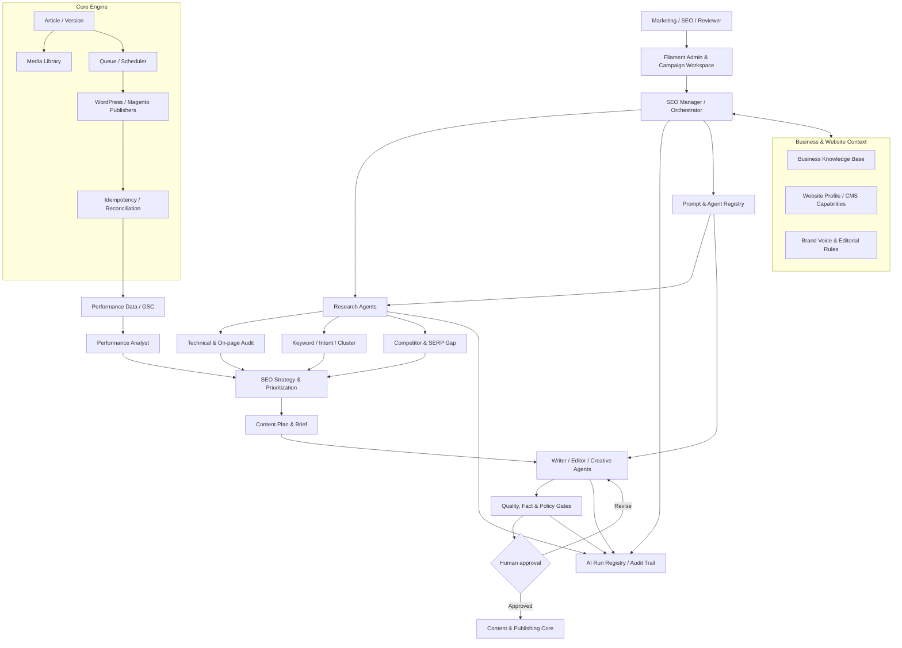
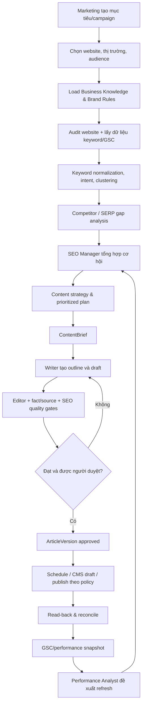

# KIẾN TRÚC AUTO-SEO AGENT PLATFORM

> **Tài liệu kiến trúc định hướng — phiên bản 1.0 — 06/11/2026**  
> Dự án: `addp-autoseo`  
> Mục đích: hợp nhất nền tảng đã triển khai, kế hoạch WBS ban đầu và kiến trúc AI SEO Agent mở rộng.

## 0. Quy ước đọc tài liệu và nguyên tắc quản lý phạm vi

Tài liệu dùng ba nhãn để tránh nhầm lẫn giữa cam kết gốc và ý tưởng mới:

| Nhãn | Ý nghĩa | Cách xử lý |
|---|---|---|
| **[ĐÃ CÓ]** | Có dấu vết trong mã nguồn, migration, contract hoặc prompt tại thời điểm khảo sát | Là baseline kỹ thuật; không đồng nghĩa đã nghiệm thu tích hợp/production |
| **[KẾ HOẠCH GỐC]** | Có trong `Kế hoạch phần mềm Auto SEO.xlsx`, các sheet TSV, `TASKS.md`, `AGENTS.md` hoặc tài liệu DEV2 | Giữ mã việc, owner, reviewer, dependency và milestone gốc; trạng thái chỉ thay đổi theo bằng chứng |
| **[CẢI THIỆN ĐỀ XUẤT]** | Bổ sung để hệ thống tiến từ AI viết bài sang nền tảng điều phối đội ngũ AI SEO/Marketing | Chưa phải cam kết WBS/giờ công; cần duyệt, estimate và phân task riêng trước khi triển khai |

**Quy tắc ưu tiên:** `AGENTS.md` và các quy tắc bảo mật/QA là ràng buộc bắt buộc; WBS gốc và `TASKS.md` là nguồn quản lý tiến độ; tài liệu này là kiến trúc đích và đề xuất tổ chức các phần mở rộng. Không được đổi trạng thái task gốc chỉ vì một phần kiến trúc đã được mô tả ở đây.

**Phạm vi khảo sát:** repository tại ngày 06/11/2026, gồm `TASKS.md`, `AGENTS.md`, `docs/plan/DEV2_IMPLEMENTATION_PLAN.md`, `docs/plan/sheets_tsv/*`, contracts, migrations, source `app/` và prompts. Mô tả [ĐÃ CÓ] chỉ xác nhận sự hiện diện của thành phần trong repo; không khẳng định CMS staging, API thật hoặc UAT đã đạt.

---

## 1. Tầm nhìn sản phẩm

Auto-SEO không nên dừng ở một công cụ nhận từ khóa rồi nhờ LLM viết bài và đẩy lên CMS. Đích đến là một **Marketing/SEO Operations Platform có AI điều phối**, hoạt động như một đội ngũ chuyên môn có quy trình, dữ liệu, vai trò, bằng chứng và người chịu trách nhiệm.

Hệ thống cần trả lời được chuỗi câu hỏi:

1. Doanh nghiệp/website đang kinh doanh gì, phục vụ ai, có sản phẩm/dịch vụ và giới hạn phát ngôn nào?
2. Website hiện có vấn đề kỹ thuật, nội dung và cơ hội tìm kiếm nào?
3. Người dùng tìm kiếm với ý định gì; từ khóa nào phù hợp và có giá trị với doanh nghiệp?
4. Đối thủ đang bao phủ chủ đề nào; khoảng trống nội dung nào có thể khai thác?
5. Nên ưu tiên chủ đề/bài nào, cho website nào, vào thời điểm nào và vì sao?
6. Bài viết/creative nào cần tạo, dựa trên nguồn nào, ai kiểm duyệt?
7. Nội dung đã được xuất bản đúng website/CMS chưa; kết quả thực tế sau xuất bản ra sao?
8. Dựa trên dữ liệu hiệu suất, hệ thống nên đề xuất cập nhật, mở rộng hay dừng nội dung nào?

### 1.1 Kết quả sản phẩm theo lớp

- **Business context:** hiểu doanh nghiệp, thương hiệu, sản phẩm, khách hàng, thị trường, giọng điệu, tài liệu và điều cấm.
- **SEO intelligence:** audit, keyword research, search intent, topic cluster, competitor gap, content strategy.
- **Content operations:** brief, outline, article, metadata, hình ảnh/creative, quality review và versioning.
- **Publishing operations:** lịch, duyệt, CMS connectors, retry có kiểm soát, idempotency và reconciliation.
- **Performance loop:** GSC/analytics, theo dõi hiệu suất, phát hiện cơ hội cập nhật và đo kết quả.
- **Agent governance:** phân vai agent, prompt/model version, run trace, nguồn dẫn, usage/cost, quyền công cụ và human approval.

## 2. Baseline: những gì dự án đã có và đã cam kết

### 2.1 Nền tảng hiện có trong repo [ĐÃ CÓ]

| Khu vực | Dấu vết hiện tại | Nhận định / giới hạn |
|---|---|---|
| Framework và vận hành | Laravel, Filament, Docker/CI, MariaDB, Redis/Queue/Scheduler theo README và cấu trúc dự án | Là nền tảng ứng dụng; cần nghiệm thu môi trường theo checklist QA, không suy ra production-ready |
| Website và credential | `Website`, migration website, `WebsiteResource`; cấu trúc lưu credential đã được định hướng mã hóa | Cần kiểm tra quyền/site-scope và thu hồi trên môi trường thật theo SEC02/SEC03 |
| Article và version | `Article`, `ArticleVersion`, migration; lưu keyword, intent, topic cluster, outline, HTML, metadata, sources, provider/model, prompt version, token/cost, review fields | Đã có khung dữ liệu sản xuất nội dung; chưa phải hệ thống knowledge retrieval hay agent trace |
| AI provider | `AiProviderInterface`, `GeminiAiProvider`, `MockAiProvider`, `TokenCostCalculator` | Đã có adapter cơ bản và đo usage/cost; cần chuẩn hóa lỗi, schema validation, prompt loading/versioning và phân biệt Mock với kết quả thật |
| Content pipeline | `ContentPipelineService`, `AiPaddingFilter`, `HtmlSanitizer` | Đã có pipeline outline → article version và bước làm sạch; chưa có pipeline nghiên cứu/chiến lược SEO hoàn chỉnh |
| Prompt | `resources/prompts/v1.0-seo-vietnamese-article.prompt.md`, `v1.0-image-alt.prompt.md` | Có prompt file; provider hiện còn xây prompt inline nên cần thống nhất cách nạp prompt và quản lý version |
| Media | `MediaAsset`, `MediaService`, `ImageOptimizer`, `MediaSecurityValidator`, `UrlSafetyService` | Đã có nền tảng media và kiểm tra an toàn; creative generation/brand asset governance là phần mở rộng |
| Publishing | `PublisherInterface`, `PublisherManager`, Magento bridge client, publish/reconcile jobs, console commands | Đã có khung publisher, queue, đối soát; WordPress connector và kiểm thử CMS thật vẫn theo task riêng |
| Contracts | `WebsiteConnection`, `ContentBrief`, `ArticleVersion`, `Publication`, `WorkflowEnum` JSON schema | Là điểm bắt đầu tốt cho contract-first; cần bổ sung contract cho SEO research, knowledge, agent run và quality report |

**Lưu ý kỹ thuật quan sát được:** `GeminiAiProvider` hiện có đường fallback sang `MockAiProvider` khi thiếu API key và cả khi JSON bài viết không hợp lệ. Đây là tiện ích cho môi trường demo/test nhưng rủi ro nếu bị hiểu là AI thật đã chạy. Kiến trúc đích yêu cầu đánh dấu provider/mode rõ ràng; lỗi parse/schema/API thật phải được ghi nhận là lỗi hoặc `needs_review`, không âm thầm thay bằng nội dung Mock trong luồng nghiệm thu.

### 2.2 Phạm vi theo kế hoạch gốc [KẾ HOẠCH GỐC]

Các mã việc dưới đây được giữ nguyên theo `TASKS.md`; bảng này diễn giải vị trí của chúng trong kiến trúc, không thay thế trạng thái tại `TASKS.md`.

| Mốc / mã việc | Nội dung gốc | Lớp kiến trúc | Ghi chú |
|---|---|---|---|
| 0.1, 0.2, 0.4 | Phạm vi/contracts, hạ tầng/CI, auth/website/credential | Platform foundation | Theo nền tảng và bảo mật |
| 0.3 | AI PoC tiếng Việt, prompt, token/cost | AI foundation | Nền móng cho provider/prompt governance |
| 0.5, 3.4, 3.5 | Filament UI, review UI, quality cơ bản | Content operations | Human-in-the-loop là bắt buộc |
| 1.2, 1.4 | WordPress và Magento connectors | Publishing integrations | Giữ riêng adapter theo CMS và capability |
| 3.1, 3.2, 3.3, 3.6 | Content pipeline, queue/scheduler, media, autopublish | Production & publishing engine | 3.6 phụ thuộc đủ connector, review và quality |
| 1.1, 1.3 | Crawler, on-page audit và báo cáo audit | SEO intelligence | Là bước đầu để hệ thống hiểu website |
| 2.1, 2.2 | Nhập keyword/CSV, AI clustering/search intent, content plan | SEO intelligence & planning | Kế hoạch gốc đã có keyword research mức khởi đầu và lịch biên tập |
| 4.1, 4.2 | Pilot, sửa lỗi và bàn giao Marketing | Release/UAT | 10 bài/CMS, 4 ngày theo kế hoạch; chỉ nghiệm thu với evidence |
| 5.1, 5.2, 5.3, 5.4 | GSC, cập nhật bài cũ, internal links, competitor gap | Performance & optimization | Là nền tảng feedback loop |
| 6.1–6.5, 7.1–7.2 | Quality nâng cao, tiếng Anh, notifications, multi-brand/RBAC, usage/AI images, hardening, stability | Scale & governance | Mở rộng sau khi luồng cốt lõi ổn định |

### 2.3 Những nội dung SEO đã có trong kế hoạch [KẾ HOẠCH GỐC]

- Crawl sitemap/URL và audit on-page cơ bản (1.1, 1.3).
- Nhập từ khóa/CSV nội bộ; gom cụm Topic Cluster và Search Intent (2.1).
- Content plan, lịch biên tập, gán keyword (2.2).
- Google Search Console read-only ở V2; không tự tạo search volume bằng AI (5.1).
- Phân tích khoảng trống đối thủ và API từ khóa trả phí (5.4).
- Quality nâng cao: trùng lặp, kiểm chứng dữ kiện, giọng thương hiệu (6.1).
- Đề xuất internal links, cập nhật bài cũ có version/diff/rollback (5.2, 5.3).
- Các quy tắc SEO/định nghĩa chỉ số nằm ở `docs/plan/sheets_tsv/12_10_tai_lieu_seo.tsv`.

Như vậy, ý tưởng SEO Intelligence không phải thay thế kế hoạch gốc. Phần lớn năng lực nghiên cứu đã được dự trù trong WBS; cải thiện chính là **kết nối các tác vụ thành một chuỗi ra quyết định có agent chịu trách nhiệm, dữ liệu đầu vào/đầu ra chuẩn hóa, truy vết và đánh giá hiệu quả**.

## 3. Kiến trúc đích tổng thể

### 3.1 Sơ đồ logic

### 3.2 Các lớp và trách nhiệm

| Lớp | Thành phần | Trách nhiệm | Nguồn gốc |
|---|---|---|---|
| L0 — Platform | Laravel, DB, Redis, queue, scheduler, auth, policies, secrets | Runtime, phân quyền, thực thi nền | [ĐÃ CÓ] + [KẾ HOẠCH GỐC] |
| L1 — Business Context | Website profile, brand profile, product/service facts, audience, editorial rules, knowledge base | Cung cấp sự thật và giới hạn cho mọi tác vụ AI | Website hiện có; Knowledge Base là [CẢI THIỆN ĐỀ XUẤT] |
| L2 — SEO Intelligence | Crawler/audit, keyword, intent, cluster, competitor, SERP evidence | Thu thập và chuẩn hóa tín hiệu SEO | Audit/keyword/competitor theo [KẾ HOẠCH GỐC]; chuẩn hóa thành agent workflow là [CẢI THIỆN ĐỀ XUẤT] |
| L3 — Strategy & Planning | SEO strategy, opportunity scoring, content plan, brief | Chọn việc nên làm, ưu tiên và giải thích lý do | Content plan theo [KẾ HOẠCH GỐC]; scoring/strategy manager là [CẢI THIỆN ĐỀ XUẤT] |
| L4 — Content Production | Outline, writer, editor, metadata, image/creative | Sản xuất nội dung theo brief, brand và nguồn | Pipeline/media theo [ĐÃ CÓ]; chuyên môn hóa agent là [CẢI THIỆN ĐỀ XUẤT] |
| L5 — Quality & Approval | SEO checks, facts, duplicate, policy, human review | Chặn nội dung thiếu nguồn, sai brief hoặc vi phạm | 3.5/6.1 và review theo [KẾ HOẠCH GỐC]; quality gate thống nhất là [CẢI THIỆN ĐỀ XUẤT] |
| L6 — Publishing | CMS adapters, schedule, publication, reconcile | Xuất bản an toàn và đọc lại trạng thái | [ĐÃ CÓ] + [KẾ HOẠCH GỐC] |
| L7 — Measurement | GSC, content performance, update recommendations | Đo kết quả và quay lại chiến lược | GSC/updates/internal links theo [KẾ HOẠCH GỐC]; vòng phản hồi tự điều phối là [CẢI THIỆN ĐỀ XUẤT] |
| Cross-cutting — Agent Governance | Agent registry, prompt registry, run registry, cost/quota, tool policy | Truy vết, kiểm soát, tối ưu và kiểm toán AI | Token/cost hiện có; registry và orchestrator là [CẢI THIỆN ĐỀ XUẤT] |

## 4. Đội ngũ AI Agent và ranh giới trách nhiệm

Không cần tạo nhiều agent ngay từ đầu. Trước tiên phải chuẩn hóa contract, prompt và run trace; sau đó tách vai trò logic. Một agent có thể dùng chung model/provider, nhưng mỗi vai trò cần mục tiêu, input/output schema, quyền công cụ và tiêu chí hoàn thành riêng.

| Vai trò | Nhiệm vụ chính | Input | Output bắt buộc | Quyền / giới hạn | Phân loại |
|---|---|---|---|---|---|
| **SEO Manager (Orchestrator)** | Nhận mục tiêu Marketing, chia task, gọi specialist, tổng hợp và đề xuất quyết định | Campaign goal, website, budget, context | Task plan, agent assignments, decision log, approval request | Không tự publish; không tự cấp quyền; không được biến nội dung crawl thành tool instruction | [CẢI THIỆN ĐỀ XUẤT] |
| **Website Auditor** | Crawl có giới hạn, kiểm tra technical/on-page, phát hiện issue | Website allowlist, sitemap, crawl policy | Audit findings, severity, affected URLs, evidence | Chỉ truy cập domain được duyệt; SSRF protection bắt buộc | Năng lực theo 1.1/1.3 [KẾ HOẠCH GỐC]; agent hóa [CẢI THIỆN] |
| **Keyword Researcher** | Nhập/chuẩn hóa keyword, phân loại intent, gom cluster, phát hiện thiếu dữ liệu | CSV, GSC, keyword provider, website context | Keyword records, intent, cluster, source, freshness | Không bịa search volume/KD; số liệu phải có nguồn và ngày | 2.1/5.1 [KẾ HOẠCH GỐC]; chuẩn hóa agent [CẢI THIỆN] |
| **Competitor Analyst** | So sánh chủ đề, SERP/content gap, điểm khác biệt | Competitors, SERP/API evidence, keyword clusters | Gap report, competitor evidence, opportunity | Không coi suy đoán AI là dữ liệu SERP; ghi rõ nguồn | 5.4 [KẾ HOẠCH GỐC]; workflow agent [CẢI THIỆN] |
| **Content Strategist** | Chọn topic, mục tiêu, funnel, ưu tiên, lịch và brief | Audit, keyword, competitor, business context | Strategy, prioritized content plan, ContentBrief | Mọi ưu tiên cần giải thích căn cứ và độ tin cậy | 2.2 [KẾ HOẠCH GỐC]; scoring/strategy [CẢI THIỆN] |
| **Writer** | Viết outline/bài/metadata theo brief và nguồn | ContentBrief, knowledge refs, prompt version | Structured article draft, citations, unresolved questions | Không tự thêm claim thực tế không có nguồn | 3.1 [KẾ HOẠCH GỐC]/[ĐÃ CÓ]; vai trò riêng [CẢI THIỆN] |
| **Editor / SEO QA** | Biên tập, kiểm tra intent, cấu trúc, keyword, readability, duplicate, schema | Draft, brief, quality rules | Quality report, issues, revision suggestions | Không tự duyệt cuối với claim nhạy cảm; không sửa mất nguồn | 3.5/6.1 [KẾ HOẠCH GỐC]; gate thống nhất [CẢI THIỆN] |
| **Creative Agent** | Đề xuất concept, ảnh minh họa, alt/caption, asset brief | Brand guide, article, media policy | Creative brief, image prompts/assets, alt text | Chỉ dùng nguồn/asset có quyền; không tạo hình gây hiểu lầm | Media/AI image 3.3/6.5 [KẾ HOẠCH GỐC]; agent hóa [CẢI THIỆN] |
| **Performance Analyst** | Đọc GSC, phát hiện giảm/tăng, đề xuất refresh/internal link | GSC snapshots, publication history | Performance insight, recommended actions | Không tự kết luận nhân quả từ tương quan; không sửa bài không duyệt | 5.1/5.2/5.3 [KẾ HOẠCH GỐC]; feedback agent [CẢI THIỆN] |

### 4.1 Nguyên tắc điều phối

1. Orchestrator tạo **task plan có cấu trúc**, không chỉ gửi một prompt dài cho nhiều vai trò.
2. Mỗi bước có `run_id`, `parent_run_id`, input/output schema, prompt version, model/provider, nguồn và trạng thái.
3. Chỉ chuyển bước khi output hợp lệ schema và qua gate tương ứng.
4. Nếu thiếu nguồn hoặc dữ liệu, agent trả `insufficient_evidence`/`needs_input`, không tự lấp bằng số liệu giả.
5. Agent có thể đề xuất hành động; server-side policy mới quyết định có được gọi tool hay không.
6. Human approval bắt buộc trước khi xuất bản; ngoại lệ tự động chỉ được mở sau khi có policy và nghiệm thu riêng.

## 5. Quy trình nghiệp vụ đầu-cuối

### 5.1 Luồng chuẩn

### 5.2 Đầu vào chiến dịch tối thiểu

- `website_id` và phạm vi CMS/store/locale.
- Mục tiêu: nhận diện, traffic, lead, chuyển đổi hay hỗ trợ khách hàng.
- Chủ đề/sản phẩm/dịch vụ và nhóm đối tượng.
- Thị trường/ngôn ngữ, thời gian và tần suất dự kiến.
- Ràng buộc: nội dung không được viết, claim cần nguồn, CTA, đối thủ cần theo dõi.
- Ngân sách AI/API và quyền truy cập dữ liệu.

Thiếu trường tùy chọn có thể dùng mặc định được cấu hình; thiếu website, mục tiêu hoặc quyền dữ liệu cần thiết thì phải dừng và yêu cầu người dùng bổ sung.

### 5.3 Cơ chế ưu tiên nội dung [CẢI THIỆN ĐỀ XUẤT]

Xây opportunity score có thể giải thích, không coi là “điểm Google”. Các yếu tố đề xuất:

- Mức phù hợp với sản phẩm/dịch vụ và mục tiêu kinh doanh.
- Search intent và khả năng đáp ứng intent.
- Bằng chứng nhu cầu tìm kiếm (GSC/keyword provider; ghi nguồn và ngày).
- Mức cạnh tranh/gap có bằng chứng.
- Độ bao phủ hiện tại, cannibalization và cơ hội internal link.
- Độ tin cậy nguồn, độ mới và chi phí sản xuất.

Score phải lưu từng thành phần, trọng số/version và lý do; không được dùng một con số tổng để che giấu thiếu dữ liệu. Khi chưa có GSC/API keyword, hệ thống chỉ xếp hạng định tính hoặc theo dữ liệu CSV nội bộ và phải gắn nhãn nguồn.

## 6. Business Knowledge Base và quản lý nguồn

<badge label="CẢI THIỆN ĐỀ XUẤT — ưu tiên nền tảng" color="warning" />

Knowledge Base là phần quan trọng nhất để AI viết đúng doanh nghiệp, nhất quán và tránh bịa thông tin. `sources_cited` ở ArticleVersion hiện là danh sách nguồn dạng text; chưa đủ để làm retrieval có kiểm soát và truy vết đến đoạn nguồn cụ thể.

### 6.1 Nhóm dữ liệu cần quản lý

1. **Company profile:** giới thiệu, pháp nhân, lĩnh vực, thị trường, năng lực.
2. **Brand profile:** giọng điệu, thuật ngữ, cách xưng hô, thông điệp, CTA, điều cấm.
3. **Product/service knowledge:** mô tả, thông số, thành phần, hướng dẫn, chứng nhận, tài liệu được duyệt.
4. **Audience/persona:** nhóm khách hàng, nhu cầu, câu hỏi, hành trình.
5. **Editorial & compliance rules:** chủ đề hạn chế, claim cần chuyên gia duyệt, disclaimer.
6. **SEO/site knowledge:** cấu trúc site, category, URL canonical, bài hiện có, internal links.
7. **External references:** tài liệu chính thức, nghiên cứu, nguồn pháp lý/kỹ thuật có quyền sử dụng.

### 6.2 Mô hình dữ liệu đề xuất

| Entity | Trường cốt lõi | Mục đích |
|---|---|---|
| `KnowledgeSource` | id, website_id/brand_id, type, origin, title, owner, trust_level, license, status | Quản lý nguồn gốc và quyền sử dụng |
| `KnowledgeDocument` | id, source_id, version, mime, checksum, language, effective_at, expires_at, ingestion_status | Quản lý file/tài liệu theo version |
| `KnowledgeChunk` | id, document_id, chunk_index, text, locator/page, metadata, embedding_ref | Đoạn nội dung dùng retrieval; lưu locator để trích dẫn |
| `KnowledgeFact` | id, subject, predicate, value, unit, source_chunk_id, valid_from/to, approval_status | Fact quan trọng có nguồn, đơn vị và hiệu lực |
| `KnowledgePolicy` | scope, rule_type, rule_json, severity, version | Điều cấm/giới hạn và yêu cầu phê duyệt |
| `KnowledgeRetrieval` | run_id, query, chunk_refs, ranking, filters | Truy vết nguồn đã đưa vào từng lần AI chạy |

### 6.3 Pipeline ingestion và retrieval

`Upload/connector → virus/MIME check → parse → normalize → classify → chunk → index → review/approve → retrieve → cite`.

- Mọi tài liệu phải có owner, trạng thái, version và quyền sử dụng.
- Tài liệu hết hạn/thu hồi không được tiếp tục đưa vào prompt.
- Retrieval phải lọc theo website/brand/role và trạng thái được duyệt.
- Prompt nhận `source_ref` cùng trích đoạn tối thiểu cần thiết; không đưa toàn bộ kho tài liệu vào context.
- Citation phải trỏ tới `KnowledgeChunk`/URL/page cụ thể, không chỉ ghi “Tài liệu công ty”.
- Nội dung từ website ngoài là **untrusted data**; không được biến thành system prompt hay quyền tool.
- Với claim ảnh hưởng sức khỏe, pháp lý, tài chính hoặc an toàn: yêu cầu nguồn có thẩm quyền và human review theo policy; thiếu nguồn thì không phát hành claim.

## 7. Prompt Registry, Agent Registry và AI Run Registry

<badge label="CẢI THIỆN ĐỀ XUẤT" color="warning" />

### 7.1 Prompt Registry

Quản lý prompt như một artifact có version, không để logic prompt rải rác trong PHP.

Trường đề xuất: `prompt_key`, `version`, `agent_role`, `task_type`, `system_template`, `user_template`, `input_schema`, `output_schema`, `model_constraints`, `temperature`, `max_tokens`, `owner`, `reviewer`, `status`, `created_at`, `approved_at`, `checksum`.

Quy tắc:
- Prompt version đã dùng trong run phải bất biến; sửa prompt tạo version mới.
- Prompt được review và test bằng fixture trước khi active.
- Tách system instruction đáng tin khỏi nội dung người dùng/crawl/tài liệu.
- Không nhúng API key, secret, dữ liệu cá nhân nhạy cảm vào prompt file.
- Prompt file trong `resources/prompts/` là nguồn version-control; DB registry có thể lưu metadata/active pointer, không tạo hai nguồn sự thật xung đột.

### 7.2 Agent Registry

Mỗi agent là một cấu hình vai trò, không nhất thiết là một service/model riêng.

Trường đề xuất: `agent_key`, `version`, `display_name`, `role`, `purpose`, `allowed_task_types`, `input_schema_ref`, `output_schema_ref`, `prompt_key`, `default_provider`, `default_model`, `tool_policy`, `budget_policy`, `timeout`, `retry_policy`, `status`.

### 7.3 AI Run Registry

Mỗi lần gọi model hoặc bước agent phải được ghi nhận độc lập.

| Trường | Ý nghĩa |
|---|---|
| `run_id`, `parent_run_id`, `correlation_id` | Quan hệ cây run và truy vết campaign |
| `campaign_id`, `website_id`, `article_id`, `task_type` | Ngữ cảnh nghiệp vụ |
| `agent_key`, `agent_version`, `prompt_key`, `prompt_version` | Cấu hình thực thi chính xác |
| `provider`, `model`, `mode` | Phân biệt Gemini/nhà cung cấp khác và Mock/Live |
| `input_payload_ref`, `output_payload_ref` | Payload có kiểm soát kích thước/retention; tránh log secret |
| `source_refs`, `tool_calls`, `policy_decisions` | Nguồn và hành động đã dùng |
| `input_tokens`, `output_tokens`, `cost`, `currency` | Usage và chi phí thực tế/ước tính được phân biệt |
| `status`, `error_code`, `error_detail`, `started_at`, `finished_at` | Kết quả, lỗi và thời gian |
| `schema_version`, `quality_result_ref` | Contract và kết quả gate |

Trạng thái run tối thiểu: `queued`, `running`, `succeeded`, `failed`, `needs_input`, `needs_review`, `cancelled`, `budget_exceeded`. Không lưu API key, credential CMS hoặc dữ liệu nhạy cảm trong payload log. Áp dụng retention và quyền truy cập theo SEC/QA.

## 8. Contract và ranh giới module

### 8.1 Giữ contract hiện có [ĐÃ CÓ]/[KẾ HOẠCH GỐC]

- `WebsiteConnection`: kết nối, CMS, store scope và credential reference.
- `ContentBrief`: campaign, primary keyword, intent, source refs, target URLs, locale.
- `ArticleVersion`: nội dung/version, metadata, nguồn, prompt/model, usage, review.
- `Publication`: website, article version, publication key, due time, timezone, remote ID/URL.
- `WorkflowEnum`: workflow chung cho nội dung/xuất bản.
- `PublisherInterface`: capability và thao tác publish/read-back theo adapter.

Không phá vỡ schema hiện hữu chỉ để thêm agent. Dùng versioning/migration có tương thích ngược; nếu cần thay đổi breaking, lập RFC và chuyển đổi dữ liệu có kế hoạch.

### 8.2 Contract bổ sung đề xuất

| Contract | Nội dung chính | Mục đích |
|---|---|---|
| `BusinessProfile` | business facts, audience, market, brand, restrictions | Ngữ cảnh doanh nghiệp |
| `KnowledgeSourceRef` | source/document/chunk/version/locator/trust | Citation có thể kiểm tra |
| `SeoAuditReport` | URL, rule, severity, evidence, recommendation, checked_at | Kết quả crawler/audit |
| `KeywordRecord` | keyword, locale, source, volume/cpc/difficulty nullable, freshness, intent | Dữ liệu keyword có nguồn |
| `KeywordCluster` | cluster, members, intent, representative keyword, confidence | Gom cụm và chủ đề |
| `CompetitorGapReport` | competitor, query/topic, evidence URLs, gap, limitations | So sánh đối thủ |
| `SeoOpportunity` | opportunity factors, score version, evidence, rationale, priority | Ưu tiên có giải thích |
| `ContentPlanItem` | brief ref, keyword cluster, target URL, status, planned date, owner | Kế hoạch biên tập |
| `QualityReport` | checks, severity, evidence, pass/fail, reviewer | Quality gate |
| `AgentTask` | task type, dependencies, assigned agent, policy, status | Orchestration |
| `AiRun` | run trace, prompt/model, usage, sources, output refs | Audit AI |

### 8.3 Nguyên tắc thiết kế module

- **SEO domain services** không phụ thuộc trực tiếp Filament UI.
- **Agent orchestration** gọi domain services qua application contracts; không để LLM tự gọi SQL hoặc shell.
- **Provider adapters** chịu trách nhiệm giao tiếp model; **agent role** chịu trách nhiệm nghiệp vụ.
- **CMS adapters** không chứa logic SEO/keyword; chỉ nhận nội dung đã được duyệt và map sang CMS.
- **Quality rules** là code/config có version, không giao toàn bộ quyết định chặn phát hành cho LLM.
- **Events/jobs** dùng idempotency, correlation ID và trạng thái rõ ràng.

## 9. Quality, evidence và human approval

### 9.1 Các tầng kiểm tra

1. **Schema gate:** output đúng JSON schema, field bắt buộc, kiểu dữ liệu và giới hạn.
2. **Source gate:** claim quan trọng có citation hợp lệ; citation tồn tại, được phép và còn hiệu lực.
3. **Business/brand gate:** đúng thông tin doanh nghiệp, sản phẩm, giọng điệu và policy.
4. **SEO gate:** intent, title/meta, heading, internal links, canonical, duplicate/cannibalization, image alt.
5. **Technical/security gate:** HTML sanitize, XSS, URL safety, media MIME/size, SSRF.
6. **Human review:** Marketing/SME phê duyệt nội dung và các claim nhạy cảm.
7. **Publication gate:** website/store mapping, credential, quota, schedule, kill switch, idempotency.
8. **Post-publish verification:** đọc lại CMS, remote ID/URL, metadata, media và publication state.

### 9.2 Evidence contract

Mọi claim hoàn thành task hoặc run phải lưu tối thiểu: `task_id`, `run_id`, commit SHA, môi trường, CMS/model version, test case, command/exit code, kết quả `pass/fail/not_run`, URL/ID đọc lại (nếu có), reviewer và giới hạn chưa kiểm chứng.

Giữ nguyên bốn mức theo `AGENTS.md`/QA: **đã viết code → mock/test giả lập → tích hợp staging → người thật nghiệm thu**. Mock pass không chứng minh API CMS thật. Không có credential/staging thì ghi `Chưa chạy` hoặc `Bị chặn tích hợp`.

## 10. Bảo mật và kiểm soát công cụ Agent

Các quy tắc trong `AGENTS.md`, sheet bảo mật và QA là bắt buộc, không phải cải thiện tùy chọn.

- **Prompt injection:** web crawl, email, file và tài liệu là dữ liệu không đáng tin. Agent không được thực thi chỉ dẫn chứa trong các nguồn này.
- **Tool allowlist:** mỗi agent có danh sách tool được phép, input schema, giới hạn domain, rate, timeout và budget. Server kiểm tra quyền trước mỗi hành động.
- **Không trao shell tùy ý:** agent nghiệp vụ không có shell, DB write trực tiếp hay quyền thay đổi credential/role.
- **Human approval:** publish, thay đổi nội dung đang live, thay credential, mở rộng domain và hành động tốn phí lớn cần policy/approval rõ.
- **SSRF:** allowlist domain, kiểm tra DNS/IP và từng redirect hop; chặn loopback/private/link-local/metadata IPv4/IPv6; giới hạn kích thước/thời gian.
- **Secrets:** mã hóa credential, key ngoài repo/prompt/log, quyền tối thiểu, thu hồi độc lập từng site.
- **Data minimization:** chỉ gửi dữ liệu cần thiết tới LLM; không gửi dữ liệu khách hàng/secret; cấu hình retention theo nhà cung cấp.
- **HTML/media:** sanitize allowlist, escape preview, kiểm MIME thật, kích thước/pixel; không thực thi file tải lên.
- **Cost control:** quota theo campaign/site/agent/model; cảnh báo và dừng khi vượt ngân sách.
- **Audit:** ghi actor, agent, run, tool, site, thời gian, quyết định và kết quả; che secret.

### 10.1 Chính sách quyền đề xuất theo vai trò

| Vai trò | Đọc | Ghi dữ liệu nội bộ | Gọi dịch vụ ngoài | Xuất bản |
|---|---|---|---|---|
| Auditor | Website được cấp | Audit report | Crawl allowlist | Không |
| Researcher | Keyword/GSC được cấp | Keyword/cluster/report | GSC/keyword provider theo scope | Không |
| Strategist | Business/SEO context | Strategy/plan/brief | Không mặc định | Không |
| Writer/Editor | Brief/knowledge refs | Draft/version/report | LLM qua provider | Không |
| Creative | Brand/media library | Creative brief/asset draft | Image provider nếu được cấp | Không |
| Performance Analyst | GSC/publication metrics | Insight/recommendation | GSC read-only | Không |
| Orchestrator | Trạng thái các task được cấp | AgentTask/run metadata | Chỉ gọi agent/tool đã allowlist | Không |
| Publisher service | Approved version + site config | Publication state | CMS API qua adapter | Chỉ theo policy và approval |

## 11. Lộ trình triển khai hợp nhất

Không đề xuất dừng hoặc viết lại nền tảng DEV1. Triển khai theo lát cắt nhỏ, bảo toàn WBS gốc. Các phần [CẢI THIỆN ĐỀ XUẤT] phải được estimate và phê duyệt trước khi đưa vào sprint.

### 11.1 Pha A — Hoàn tất luồng V1 theo kế hoạch gốc

**[KẾ HOẠCH GỐC]** Hoàn thiện các mã còn lại của V1.0/V1.1: UI Filament, WordPress connector, review UI, quality cơ bản, autopublish, QA và staging. Không bật tự động publish nếu chưa đạt điều kiện QA/SEC; ưu tiên nháp và human approval.

Điều kiện kết thúc: một luồng AI tạo → lưu version → review → tạo nháp CMS → đọc lại được chứng minh; lỗi timeout không tạo bài trùng; quyền và kill switch được kiểm tra.

### 11.2 Pha B — SEO Intelligence V1.2 theo kế hoạch gốc

**[KẾ HOẠCH GỐC]** Triển khai 1.1 crawler/audit, 1.3 audit report, 2.1 keyword import/clustering, 2.2 content plan, sau đó pilot 4.1 và bàn giao 4.2.

**[CẢI THIỆN ĐỀ XUẤT — bổ sung có kiểm soát]** Khi code các task trên, thiết kế output theo các contract `SeoAuditReport`, `KeywordRecord`, `KeywordCluster`, `ContentPlanItem`; lưu nguồn, ngày thu thập, độ tin cậy và giới hạn dữ liệu ngay từ đầu. Điều này giúp tránh phải viết lại khi thêm Agent Orchestrator.

### 11.3 Pha C — Agent Governance Foundation (đề xuất bổ sung)

**[CẢI THIỆN ĐỀ XUẤT]** Làm nền tảng quản trị AI trước khi tạo nhiều agent:

1. Prompt Registry tối thiểu: prompt file + metadata/version + test fixtures.
2. AI Run Registry: run ID, model, prompt version, input/output refs, source refs, usage/cost, status/error.
3. Structured output validation: schema validation và trạng thái lỗi minh bạch.
4. Tool policy: allowlist theo agent/task, budget/timeout, không có quyền publish.

Không cần xây giao diện registry phức tạp ngay; có thể bắt đầu bằng migration/service/admin read-only và mở rộng sau khi workflow ổn định.

### 11.4 Pha D — Knowledge Base & SEO Manager (đề xuất bổ sung)

**[CẢI THIỆN ĐỀ XUẤT]**

- D1: KnowledgeSource/Document/Chunk, ingestion, approval, source references và retrieval.
- D2: AgentTask + SEO Manager điều phối các domain service đã có.
- D3: tách Website Auditor, Keyword Researcher, Competitor Analyst và Content Strategist thành role có contract.
- D4: Writer/Editor/Creative dùng chung Content Pipeline hiện tại qua adapter; không tạo pipeline viết bài thứ hai.

### 11.5 Pha E — Performance feedback loop

**[KẾ HOẠCH GỐC]** Hoàn thành GSC 5.1, article update 5.2, internal links 5.3, competitor gap 5.4, quality plus 6.1.  
**[CẢI THIỆN ĐỀ XUẤT]** Tạo Performance Analyst tổng hợp số liệu thành đề xuất refresh có bằng chứng; mọi cập nhật bài live cần diff, conflict detection, rollback và duyệt.

### 11.6 Pha F — Scale và tối ưu

**[KẾ HOẠCH GỐC]** Hoàn thiện multi-brand/RBAC, notifications, AI usage/images, hardening, stability, tiếng Anh theo WBS.  
**[CẢI THIỆN ĐỀ XUẤT]** Khi có đủ run data mới tối ưu model routing, cache prompt, agent collaboration và tự động hóa sâu hơn.

### 11.7 Bảng đề xuất mã việc mới (không thay thế mã gốc)

| Mã đề xuất | Hạng mục | Ưu tiên | Phụ thuộc | Phân loại | Điều kiện nghiệm thu gợi ý |
|---|---|---:|---|---|---|
| ARCH-01 | Prompt Registry + prompt loader/version tests | P0 | 0.3/3.1 | Cải thiện | Một run xác định chính xác prompt version/checksum; không còn prompt logic phân tán |
| ARCH-02 | AI Run Registry + usage/error trace | P0 | 0.3/3.1 | Cải thiện | Truy vấn được cây run, model, source, cost và trạng thái; không log secret |
| ARCH-03 | Structured output/schema gate + Mock/Live separation | P0 | 3.1/3.5 | Cải thiện | JSON sai/schema sai/API fail không bị giả thành thành công Mock |
| ARCH-04 | Knowledge Base ingestion/retrieval/citations | P1 | 0.4/1.1 | Cải thiện | Bài dẫn được chunk/page nguồn đã duyệt; retrieval lọc theo site/brand |
| ARCH-05 | Agent Registry + tool/budget policy | P1 | ARCH-01/02 | Cải thiện | Agent role có schema, tool allowlist, budget và policy được kiểm tra phía server |
| ARCH-06 | SEO Manager / Agent Orchestrator | P1 | ARCH-02/03/05, 1.1/2.1/2.2 | Cải thiện | Tạo task graph, chạy từng bước, retry có kiểm soát, dừng khi thiếu input và lưu decision trace |
| ARCH-07 | SEO Opportunity Scoring | P1 | 2.1/2.2/5.1/5.4 | Cải thiện | Score giải thích được, có evidence/weight version và xử lý null data |
| ARCH-08 | Performance Analyst workflow | P2 | 5.1/5.2/5.3 | Cải thiện | Phát hiện cơ hội và tạo đề xuất; không tự sửa bài live |
| ARCH-09 | Creative Agent workflow | P2 | 3.3/6.5 | Cải thiện | Sinh brief/asset draft theo brand, license và review gate |

Các mã ARCH là mã kiến trúc gợi ý để thảo luận; chưa được thêm vào `TASKS.md`, chưa có owner/giờ/hạn và không được cộng vào tổng giờ gốc 432h + dự phòng 64,8h cho tới khi được duyệt estimate.

## 12. Thứ tự ưu tiên kỹ thuật và quyết định thiết kế

### P0 — Làm ngay khi hoàn thiện pipeline hiện tại

1. Không fallback im lặng từ Gemini lỗi sang Mock trong môi trường staging/production. Mock chỉ được bật bằng config môi trường/test rõ ràng và mọi output phải gắn `mode=mock`.
2. Prompt trong `resources/prompts/` phải thực sự là nguồn prompt được provider sử dụng; prompt version phải đi cùng ArticleVersion/AI run.
3. Validate JSON/schema, giới hạn HTML, field required và citation; lỗi phải có error code và không tạo ArticleVersion giả thành công.
4. Gắn `run_id`/correlation ID và ghi usage/cost thực tế hoặc trạng thái unavailable; không mặc định token khi API không trả usage.
5. Chuẩn hóa contract SEO từ các task 1.1/1.3/2.1/2.2 để dữ liệu có nguồn và có thể tái sử dụng.

### P1 — Xây năng lực đội ngũ AI

1. Knowledge Base ingestion/retrieval/citation.
2. Agent Registry + Prompt Registry + AI Run Registry.
3. SEO Manager điều phối task graph qua domain service.
4. Competitor/Keyword/Strategy agents với contract và evidence.

### P2 — Tối ưu theo dữ liệu thật

1. Performance Analyst và refresh recommendations.
2. Model routing theo chất lượng/chi phí/latency.
3. Creative Agent và đa phương thức.
4. Tự động hóa nhiều bước chỉ sau khi đủ số liệu và kiểm thử rủi ro.

## 13. Phân công Dev1/Dev2 và nguyên tắc phối hợp

Giữ nguyên phân vai `AGENTS.md`:

- **Dev1:** hạ tầng/backend core, database/migrations theo PR, Magento, queue/scheduler, publisher core, bảo mật nền và vận hành.
- **Dev2:** Filament UI, WordPress, prompt/AI UX, SEO audit/planning, quality và QA theo WBS.
- **Hai Dev:** review chéo contracts, AI run/knowledge, security, integration và nghiệm thu.

Đề xuất phân bổ bổ sung (cần thống nhất trước khi tạo task):

| Nhóm | Owner đề xuất | Reviewer | Lưu ý |
|---|---|---|---|
| Prompt Registry / prompt loader | Dev2 | Dev1 | Dev2 quản prompt nghiệp vụ; Dev1 review adapter/runtime |
| AI Run Registry / migrations | Dev1 | Dev2 | Contract phải thống nhất trước migration |
| Knowledge ingestion/retrieval | Dev2 domain / Dev1 infra | Hai chiều | Chốt parser, storage, vector backend và quyền dữ liệu trước |
| Agent orchestration | Dev1 application/runtime + Dev2 agent definitions | Hai chiều | Không cho orchestrator bypass policies |
| SEO specialist agents | Dev2 | Dev1 | Tái sử dụng domain service; không nhân đôi logic |
| Security/tool policy | Dev1 | Dev2 | Security review độc lập trước bật tool |

Mọi task mới tuân thủ `AGENTS.md`: task ID, owner/reviewer, branch/worktree, allowlist, contract version, fixtures, tests, ngân sách/quyền API và điều kiện dừng. Agent phát triển không tự approve/merge/deploy.

## 14. Rủi ro chính và cách giảm thiểu

| Rủi ro | Hệ quả | Biện pháp |
|---|---|---|
| Xây quá nhiều agent quá sớm | Phức tạp, khó debug, chi phí cao | Chuẩn hóa run/prompt/schema trước; bắt đầu từ role logic, ít agent |
| Không có Knowledge Base đáng tin | AI viết sai thông tin doanh nghiệp | Source ownership, approval, expiry, retrieval filters và citations |
| Số liệu SEO do AI tự suy ra | Quyết định sai, báo cáo mất tin cậy | Chỉ dùng số liệu từ GSC/API/CSV; nullable + source + collected_at |
| Prompt drift | Chất lượng thay đổi không truy nguyên | Prompt version bất biến, fixtures, checksum và run trace |
| Mock bị hiểu là kết quả thật | Nghiệm thu sai | Tách mode, môi trường, badge/log và CI test riêng |
| Agent gọi tool quá quyền | SSRF, lộ dữ liệu, hành động trái phép | Server-side allowlist, policy engine, egress control, human approval |
| Publish trùng khi timeout | Bài trùng trên CMS | publication_key, needs_reconcile, read-back; không retry mù |
| Scope creep ngoài WBS | Trễ milestone, thiếu owner | Mã ARCH riêng, estimate/phê duyệt; không tự cộng giờ gốc |
| GSC/competitor data thiếu | Kết luận thiếu căn cứ | Gắn coverage/limitations; không biến missing thành zero |

## 15. Điều kiện để coi kiến trúc Agent sẵn sàng

- [ ] Các task V1 cốt lõi có evidence theo bốn mức kiểm chứng; WordPress/Magento được nghiệm thu riêng.
- [ ] Prompt version được nạp thật từ registry/source-of-truth và gắn với mọi run.
- [ ] Mock và Live tách biệt; lỗi provider/parse/schema không bị che giấu.
- [ ] AI Run Registry truy vết được input/output/source/model/prompt/cost/error.
- [ ] Knowledge Base có owner, version, approval, expiry và citation đến chunk/page.
- [ ] Agent có input/output schema, tool allowlist, budget, timeout và policy.
- [ ] Orchestrator chạy task graph có retry/dừng/needs_input; không tự publish.
- [ ] Quality gate có rule code và human approval cho nội dung nhạy cảm.
- [ ] Tool/crawl bảo vệ SSRF và prompt injection theo SEC04/SEC06.
- [ ] Mọi publish có idempotency, reconcile, kill switch và post-publish read-back.
- [ ] Performance data có nguồn, bộ lọc, ngày và không bị AI tạo giả.

## 16. Tài liệu nguồn trong repository

- `AGENTS.md` — quy tắc kỹ thuật, bảo mật, bằng chứng và phân vai.
- `TASKS.md` — mã việc, milestone, owner, reviewer và trạng thái.
- `README.md` — mục tiêu sản phẩm, stack và milestone.
- `docs/plan/plan.xlsx` — kế hoạch gốc.
- `docs/plan/sheets_tsv/01_11_lo_trinh.tsv` — lộ trình.
- `docs/plan/sheets_tsv/02_12_muc_tieu.tsv` — mục tiêu/mốc.
- `docs/plan/sheets_tsv/03_21_chi_tiet_cong_viec.tsv` — WBS chi tiết.
- `docs/plan/sheets_tsv/08_8_kiem_chung_ai.tsv` — QA/evidence contract.
- `docs/plan/sheets_tsv/09_9_bao_mat_he_thong.tsv` — security controls.
- `docs/plan/sheets_tsv/10_3_ket_noi_website.tsv` — CMS/AI integration.
- `docs/plan/sheets_tsv/12_10_tai_lieu_seo.tsv` — SEO metrics/rules.
- `docs/plan/sheets_tsv/13_11_dac_ta_nghiem_thu.tsv` — contracts và acceptance criteria.
- `docs/plan/DEV2_IMPLEMENTATION_PLAN.md` — phân tích phạm vi/triển khai Dev2.
- `contracts/` — JSON schemas hiện có.
- `app/Services/Ai/`, `app/Services/Content/`, `app/Jobs/`, `app/Integrations/` — implementation baseline.
- `resources/prompts/` — prompt files hiện có.

---

## 17. Quyết định cần chốt trước khi code phần cải thiện

1. **Knowledge storage:** bắt đầu bằng MariaDB full-text + chunk table hay triển khai vector database riêng? Ưu tiên phương án ít vận hành, có thể thay backend qua interface.
2. **Nguồn tài liệu:** tài liệu nào là nguồn chuẩn, ai là owner/reviewer, quy trình hết hạn/thu hồi ra sao?
3. **Agent runtime:** orchestration nội bộ Laravel Jobs/Services hay dùng framework bên ngoài? Khuyến nghị bắt đầu nội bộ để giữ quyền kiểm soát, chỉ thêm framework khi có nhu cầu rõ.
4. **LLM providers:** model/provider nào được phép, dữ liệu nào được gửi, quota/cost và retention ra sao?
5. **Approval policy:** ai được duyệt bài, ai được duyệt claim nhạy cảm, điều kiện nào mới được tự publish?
6. **WBS bổ sung:** owner, reviewer, estimate, milestone và ngân sách cho ARCH-01…ARCH-09.

**Khuyến nghị quyết định:** không xây một “đội quân agent” ngay lập tức. Hoàn thiện SEO data contracts + prompt/run governance + knowledge retrieval trước; sau đó đưa SEO Manager vào điều phối những năng lực đã có trong WBS. Đây là con đường ít rủi ro nhất để giữ lại công sức DEV1/DEV2 và tiến dần tới hệ thống AI SEO/Marketing có thể vận hành, đo lường và kiểm toán.
