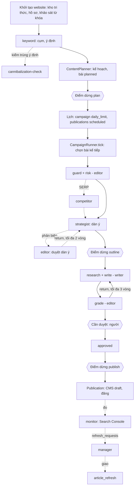
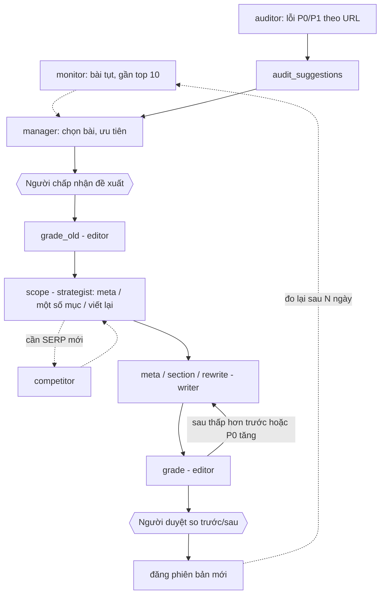
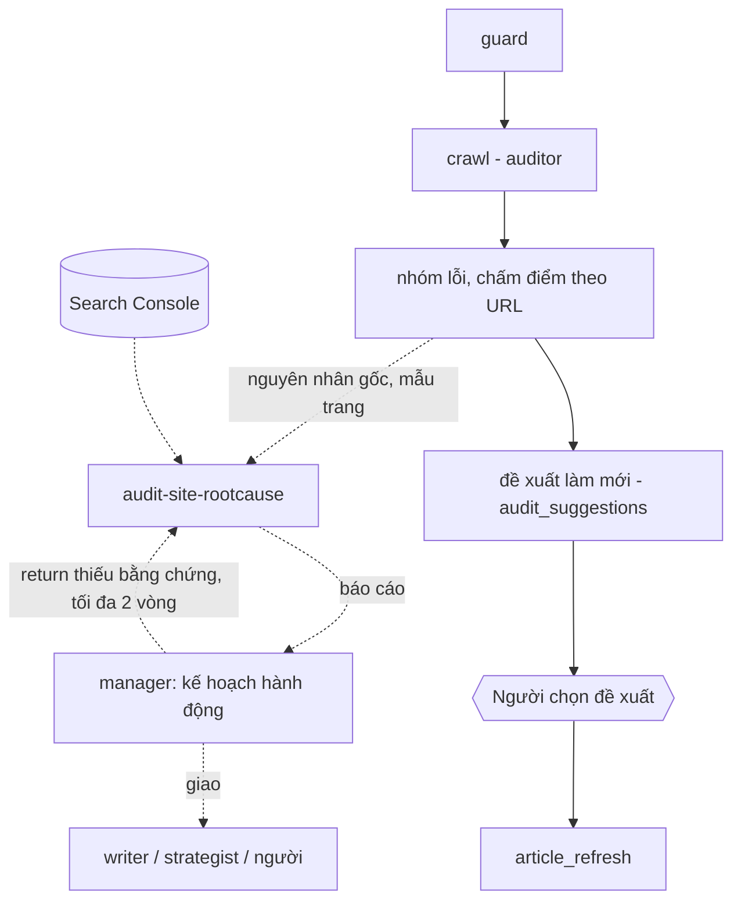
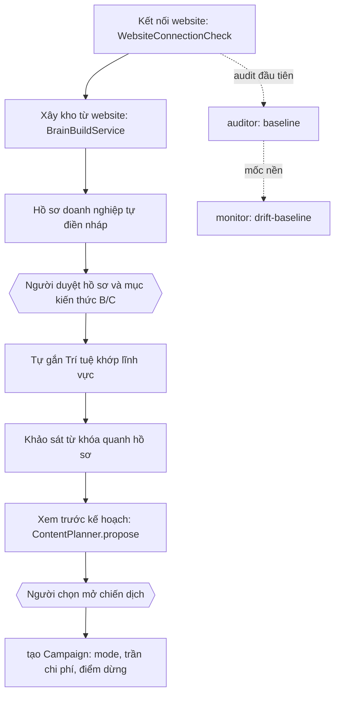
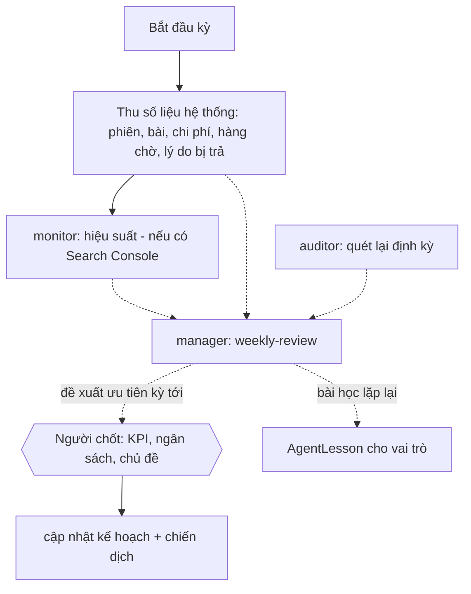

# Thiết kế quy trình làm việc của 9 vai trò đội AI (8 vai trò SEO + Họa viên hình ảnh)

> v2.0 · 12/11/2026 · **Tài liệu thiết kế**, không phải mô tả hệ thống đang chạy. Đi kèm: [SKILL_MAP.md](SKILL_MAP.md) (kỹ năng, nguồn, ưu tiên) và [SYSTEM_INTEGRATION.md](SYSTEM_INTEGRATION.md) (khớp với từng thành phần hệ thống, khoảng trống code, việc cần làm).
> Quy ước nhãn: **[NỐI]** = có mã thật trong `AgentRunOrchestrator`/mã hiện có và test đối chiếu (mới kiểm bằng AI giả lập, chưa thử model thật, chưa có người nghiệm thu) · **[MÃ-NGOÀI]** = có mã chạy thật nhưng không qua vai trò AI (ví dụ `AuditWebsiteCommand`, `ContentPlanner`) · **[TK]** = thiết kế, chưa có mã · **[DỮ-LIỆU]** = cần nguồn dữ liệu ngoài chưa có.
> Phiên này không thêm bước nào vào orchestrator. Gắn Gemini API và chạy bài thật là phiên khác.

## 1. Hiện trạng (đọc từ mã)

Luồng chạy thật của đội AI chỉ có **một** đường: `AgentRunOrchestrator::run` cho một bài đã có từ khóa (job-type `article_write`; cũng là đường lùi của `article_refresh` nhánh viết lại): `guard → risk → brief → research → write → images → grade ↔ repair (≤3 vòng) → handoff`. `RoleRegistry::STEP_ROLE` gán bước cho strategist, writer, editor, **designer** (bước `images`, từ giai đoạn 3) và `system`.

Quanh đó có nhiều mã chạy thật **không qua vai trò AI**: `CampaignRunner` (nhịp, giới hạn bài/ngày, trần chi phí, tự duyệt chế độ Toàn quyền), `AutopilotRunner` (khảo sát từ khóa → `ContentPlanner` → hàng chờ), `AuditWebsiteCommand` + `AuditSuggestionService`, `ArticleRefreshRunner`, `CmsDraftHandoff` + `PublishArticleJob`, `BrainBuildService`.

| Vai trò | Nhận gì (thật) | Trả gì (thật) | Trạng thái |
|---|---|---|---|
| strategist | từ khóa chính, hồ sơ doanh nghiệp, chỉ dẫn của người phụ trách bài | dàn ý `{title, outline[]}` | **[NỐI]** `brief` (có thể tắt) |
| writer | dàn ý, kiến thức/ảnh/liên kết nội bộ từ bước `research`, mã luật cần sửa | bản nháp + meta | **[NỐI]** `write`, `repair` (khóa, không tắt được) |
| editor | bản nháp | báo cáo luật P0/P1/P2; hạng rủi ro | **[NỐI]** `risk`, `grade` — bước **máy** (`ContentQualityChecker`), không phải AI phản biện |
| designer | bài, H2, ảnh thư viện, hồ sơ doanh nghiệp | ảnh bìa + ảnh theo mục (AI tạo, có nhãn), bước `images` | **[NỐI]** `images` (tắt được; model ảnh gán riêng; xem 3.10) |
| auditor | domain được phép | nhóm lỗi, điểm theo URL, đề xuất làm mới | **[MÃ-NGOÀI]** (`autoseo:audit-website`); chưa qua đội AI |
| keyword | từ khóa, hồ sơ | đề xuất từ khóa, cụm | **[MÃ-NGOÀI]** (`KeywordResearchService`, nút Gom cụm); `orchestrator_steps` rỗng |
| competitor | — | — | **[TK]** + **[DỮ-LIỆU]** SERP; trang Đối thủ là dữ liệu minh họa |
| monitor | — | — | **[TK]** + **[DỮ-LIỆU]** Search Console; trang Search Console là dữ liệu minh họa |
| manager | — | — | **[TK]** (`idea`); thứ tự bước do mã cố định |

**Lỗ hổng gốc**
1. Luồng tuyến tính: mỗi bước nhận đầu ra bước trước, không ai có quyền "không đồng ý".
2. Phản hồi giữa các vai trò chỉ là mã luật; không có "lý do trả bài" có cấu trúc, người nhận, hay số vòng theo cặp.
3. Viết bài **trước** khi phân tích SERP/đối thủ.
4. Không có vòng phản hồi sau xuất bản (Search Console).
5. Không vai trò nào sở hữu: liên kết nội bộ theo cụm, schema, backlink/PR, SEO local, làm lại bài theo dữ liệu, tổng kết định kỳ.
6. Vai trò nằm ngoài orchestrator (audit, từ khóa, kế hoạch) không để lại dấu vết thống nhất trong `agent_run_steps` nên "Đội AI hôm nay" không thấy hết việc.

---

## 2. Nguyên tắc chung

### 2.1 Phong bì trao đổi (handoff) — [TK]
Mọi lần A giao B là một bản ghi có cấu trúc, lưu vào `agent_run_steps.data` (JSON có sẵn, **không cần migration**):

```json
{
  "kind": "deliver|return|question|escalate",
  "from": "strategist", "to": "writer",
  "artifact_ref": "brief@3",
  "summary": "string",
  "evidence": ["ref tới dữ liệu đầu vào"],
  "limitations": ["Chưa có dữ liệu SERP"],
  "round": 1
}
```

### 2.2 Trả bài có lý do (`return`) — [TK]
```json
{
  "kind": "return", "from": "editor", "to": "strategist", "round": 2,
  "reason_code": "OUTLINE_INTENT_MISMATCH|THIN_COVERAGE|MISSING_EVIDENCE|OFF_TOPIC|RISK_UNSOURCED|DUPLICATE_INTENT|SCOPE_TOO_LARGE|OTHER",
  "reason": "nêu lỗi bằng lời, chỉ đúng mục",
  "must_fix": ["..."], "may_ignore": ["..."],
  "rubric_codes": ["HEAD01"]
}
```
- Bên bị trả phải trả lời bằng `deliver` (nêu đã đổi gì) hoặc `question`/`escalate` (không đồng ý, nêu lý do). Không được im lặng sửa hoặc bỏ qua.
- **Tối đa 2 vòng cho mỗi cặp (từ → đến) trên một sản phẩm** (con số đề xuất, chưa hiệu chỉnh); bước viết/sửa với luật máy giữ nguyên tối đa 3 vòng hiện có (`maxRepairRounds`).
- Lỗi luật máy (P0) **không thương lượng**. Nhận xét mềm (`may_ignore`) bên bị trả được phản đối có lý do.
- Không vai trò nào hạ P0, nới ngưỡng, hay sửa sản phẩm của vai trò khác.
- Bài học: lý do trả lặp lại ≥ 3 lần cho cùng vai trò đề xuất thành `AgentLesson` (có sẵn, người duyệt bật) — [TK].

### 2.3 Phản biện: ai phản biện ai — [TK]
| Sản phẩm | Người làm | Người phản biện | Phản biện cái gì |
|---|---|---|---|
| Cụm từ khóa | keyword | strategist | Lệch chủ đề website, trùng ý định |
| Phân tích SERP | competitor | strategist | Kết luận có nguồn không; website làm được không |
| Dàn ý | strategist | **editor** (đạt ý định, bằng chứng), **writer** (viết được không) | Editor trả `OUTLINE_INTENT_MISMATCH`; writer hỏi lại khi mục thiếu nguồn |
| Bản nháp | writer | editor (luật máy + E-E-A-T định tính) | Cổng P0 + `must_fix` |
| Báo cáo audit | auditor | manager | Bằng chứng, nguyên nhân gốc |
| Kế hoạch hành động | manager | người | Duyệt trước khi chạy hàng loạt |
| Cảnh báo tụt | monitor | manager | Đủ ngưỡng, loại nhiễu, đủ tuổi bài |

Quy tắc chống "đồng ý cho xong": phản biện không được chỉ viết "OK". Một `deliver` của người phản biện phải nêu ít nhất một điều đã kiểm (`checked`) và dữ liệu đối chiếu; thiếu thì mã coi là chưa phản biện — [TK].

### 2.4 Cổng người duyệt (human gate) — đã có và đề xuất
| Điểm | Hiện có | Đề xuất |
|---|---|---|
| Sau kế hoạch | điểm dừng `plan` của chiến dịch **[NỐI]** | giữ |
| Sau dàn ý | điểm dừng `outline` **[NỐI]** | giữ; bắt buộc cho chủ đề rủi ro cao |
| Sau bản nháp | điểm dừng `draft`; hàng chờ "Cần duyệt" **[NỐI]** | giữ |
| Trước đăng | điểm dừng `publish`; bậc tin cậy (Mức 2 bị khóa cứng) **[NỐI]** | giữ |
| Sửa bài đã đăng, chèn liên kết vào bài đã đăng | — | **luôn qua người** [TK] |
| Hành động ra ngoài (email PR, GBP) | — | **luôn người làm**, AI chỉ gợi ý [TK] |
| Kế hoạch hành động hàng loạt của manager | — | người xem trước [TK] |

### 2.5 Thiếu dữ liệu: nói thẳng
Mỗi sản phẩm bắt buộc có `limitations`. Thiếu nguồn: ghi "Chưa có dữ liệu", không điền số, trạng thái `no_*_data`, dừng bước đó (không dừng cả chiến dịch trừ khi bước là bắt buộc). Vai trò nhận phải chuyển tiếp `limitations`, không xóa. Hạ cấp có tên: ví dụ competitor không có SERP thật thì **không viết "dựa trên SERP"**.

---

## 3. Quy trình từng vai trò

Cách đọc: *Bước* = việc theo thứ tự · *Kỹ năng* = playbook `role/key` dùng ở bước đó (nháp, chưa active) · *Dữ liệu hệ thống* = bảng/model thật · *Trả lại* = điều kiện và người nhận.

### 3.1 Quản lý SEO — `manager` — **[TK]**, `idea`
- **Như người thật:** trưởng nhóm SEO: nhìn mục tiêu, chọn việc, giao đúng người, theo dõi, mỗi tuần tổng kết; **không tự đo**.
- **Bước:**
  1. Nhận báo cáo các vai trò + số liệu hệ thống (kỹ năng `manager/seo-orchestrator`).
  2. Gộp phát hiện thành hành động có thứ tự: `evidence`, `depends_on`, `verify_by`, `failure_signal`, `owner_role`, `reversible`.
  3. Hành động không đảo ngược được hoặc chạm bài đã đăng → `needs_human`.
  4. Giao việc theo hạn mức song song; mỗi vai trò chỉ nhận việc thuộc loại của nó.
  5. Hằng tuần/tháng: tổng kết (`manager/weekly-review`).
- **Đầu vào:** báo cáo JSON của vai trò; `agent_runs`, `agent_run_steps`, `articles` theo `workflow_status`, `campaign_waits`, `knowledge_gaps`, chi phí AI.
- **Đầu ra:** `{summary, actions[{id, priority, title, owner_role, playbook_ref, evidence, depends_on, verify_by, failure_signal, reversible}], needs_human, limitations}` (schema của `manager/seo-orchestrator`); báo cáo kỳ theo `manager/weekly-review`.
- **Đạt:** mọi hành động đủ trường; đồ thị phụ thuộc không vòng; không vượt hạn mức; `limitations` không rỗng khi có báo cáo thiếu dữ liệu.
- **Trả lại:** báo cáo thiếu bằng chứng → `return MISSING_EVIDENCE` về đúng vai trò (tối đa 2 vòng). Người từ chối kế hoạch → manager bổ sung một lần rồi dừng.
- **Người duyệt:** kế hoạch hàng loạt; không bao giờ tự đổi cài đặt chiến dịch.
- **Thiếu dữ liệu:** không có Search Console thì tổng kết ghi "chưa đo được hiệu quả thật", chỉ báo số vận hành.
- **Khớp hệ thống:** hiện việc "chọn việc kế tiếp" do `CampaignRunner::nextPlanned` + `AutopilotRunner` + `ContentPlanner` làm bằng luật. Đề xuất: manager **chỉ khuyến nghị** trước khi thay mã luật (xem SYSTEM_INTEGRATION).

### 3.2 Nghiên cứu từ khóa — `keyword` — **[MÃ-NGOÀI]** + **[TK]** phần còn lại
- **Như người thật:** gom từ khóa, hiểu ý định, tránh hai bài tranh nhau một ý định, chia cụm (trụ cột + vệ tinh), thêm yếu tố địa phương khi cần.
- **Bước:**
  1. Thu: kho từ khóa (`keywords`), CSV, khảo sát AI quanh hồ sơ **[MÃ-NGOÀI: `KeywordResearchService`]**; volume qua DataForSEO nếu có khóa (`KeywordMetricsEnricher`).
  2. Gom cụm, gán ý định **[MÃ-NGOÀI: `keyword_cluster`]** (`researcher/keyword-cluster`).
  3. Kiểm trùng ý định với bài có sẵn (`researcher/cannibalization-check`) — [TK].
  4. Doanh nghiệp địa phương: từ khóa theo khu vực (`researcher/local-keywords`) — [TK].
  5. Giao cụm cho strategist; `keyword_gaps` cho kế hoạch.
- **Đầu vào/đầu ra:** schema cụm `{clusters[{id, pillar_keyword, intent, members[{keyword, volume|null, volume_source}], existing_article_ids, cannibalization_risk, confidence}], limitations}`.
- **Đạt:** mỗi cụm có từ khóa chính và ý định; một từ khóa chỉ ở một cụm; volume `null` nếu không có nguồn.
- **Trả lại:** strategist trả `OFF_TOPIC`/`DUPLICATE_INTENT` → về keyword, ≤2 vòng, rồi đánh dấu cụm "chưa chắc".
- **Người duyệt:** xem danh sách cụm trước khi vào kế hoạch (đã là thiết kế trang Từ khóa).
- **Thiếu dữ liệu:** không có Search Console/SERP → độ tin cậy cụm tối đa `medium`; không có volume → hiển thị "Chưa có", `ContentPlanner` đã xếp hạng không dựa volume giả.
- **Khớp hệ thống:** ghi `keywords.status`, `keyword_clusters`; đọc `articles` để kiểm trùng.

### 3.3 Phân tích đối thủ / SERP — `competitor` — **[TK]** + **[DỮ-LIỆU]**
- **Như người thật:** trước khi viết, xem top kết quả là loại trang gì, họ có gì mình thiếu, mình có góc riêng gì.
- **Bước (kỹ năng `analyst/serp-gap`, `analyst/backlink-gap`):**
  1. Cổng dữ liệu: cần ≥5 kết quả SERP thật đã duyệt, ngược lại `no_serp_data` và **dừng**.
  2. Lọc đối thủ không thật (bách khoa, mạng xã hội, sàn...).
  3. Loại trang chủ đạo và mức đồng thuận; so với loại trang của mình.
  4. Khoảng trống (thiếu chủ đề / nông / chất lượng thấp) kèm `source_url`.
  5. Loại khoảng trống website không đáp ứng được (theo hồ sơ doanh nghiệp).
  6. Sinh `content_requirements` cho strategist.
  7. Quý/tháng: khoảng trống liên kết (`analyst/backlink-gap`) → danh sách cho người làm PR.
- **Đầu ra:** `serp-gap` JSON (đã có) + `content_requirements {must_cover[{topic, source_url}], page_type, serp_features[], own_angle}`.
- **Đạt:** `status: ok` ⇒ `serp_results_used ≥ 5`, mọi nhận định có `source_url` trong đầu vào.
- **Trả lại:** strategist trả `MISSING_EVIDENCE`/`OFF_TOPIC` → về competitor ≤2 vòng; sau đó loại nhận định.
- **Người duyệt:** danh sách đối thủ thật (`competitors.kind = truc_tiep`) do người xác nhận.
- **Thiếu dữ liệu:** chế độ giảm cấp = đối thủ do người nhập + trang công khai quét an toàn (`UrlSafetyService`); ghi "không dựa trên SERP".
- **Khớp hệ thống:** đọc/ghi `competitors`; trang Đối thủ hiện là dữ liệu minh họa.

### 3.4 Chiến lược nội dung — `strategist` — **[NỐI]** `brief`; phần còn lại **[TK]**
- **Như người thật:** biến ý định + khoảng trống thành dàn ý; đặt liên kết nội bộ theo cụm; chọn schema theo loại trang; quyết bài mới hay làm lại.
- **Bước:**
  1. Đọc cụm (keyword), `content_requirements` (competitor), hạng rủi ro (editor) — chỉ phần đầu có thật.
  2. **[NỐI]** Lập dàn ý (`brief/content-brief`): tiêu đề, H2 theo ý định; kiểm `looksOffTopic` (Website Relevance Rule).
  3. Kế hoạch liên kết nội bộ theo cụm (`strategist/internal-linking`) — [TK].
  4. Chọn loại schema (`strategist/schema-plan`) — [TK].
  5. Làm lại bài: phân loại phạm vi sửa (tiêu đề/meta, một số mục, viết lại) — **[NỐI bằng luật]** trong `ArticleRefreshRunner` (`RefreshScope`); bản có dữ liệu Search Console — [TK].
  6. Lập kế hoạch nội dung theo cụm (`strategist/content-plan`) — **[MÃ-NGOÀI]** `ContentPlanner`.
- **Đầu ra hiện tại:** `{title, outline[]}`. **Thiết kế mở rộng:**
```json
{"title":"","search_intent":"","outline":[{"h2":"","answers_question":"","must_cover_ref":""}],
 "internal_links":[{"anchor":"","target_article_id":0,"reason":"pillar|spoke|related"}],
 "schema_type":"Article|FAQPage|HowTo|Product|LocalBusiness|none",
 "target_cluster_id":"","limitations":[]}
```
- **Đạt:** mỗi H2 trả lời một câu hỏi người đọc; không số liệu không nguồn; liên kết chỉ trỏ bài đã đăng; schema chỉ khi nội dung có thật.
- **Trả lại:** editor `OUTLINE_INTENT_MISMATCH`/`RISK_UNSOURCED`; writer `question` (mục thiếu nguồn); cả hai về strategist, ≤2 vòng, hết vòng → điểm dừng `outline` cho người.
- **Người duyệt:** điểm dừng `outline` (có thể sửa dàn ý, đã **[NỐI]** qua `OutlineHold`).
- **Thiếu dữ liệu:** không SERP → dàn ý theo ý định + kiến thức đã duyệt, ghi giới hạn. Không có cụm → `cluster_missing`, không đoán liên kết.
- **Khớp hệ thống:** đọc `keyword_clusters`, `articles`, `brand_profiles`, `knowledge_items` (qua `KnowledgeRetriever`); ghi `agent_run_steps.data.outline`.

### 3.5 Người viết — `writer` — **[NỐI]** `write`, `repair`
- **Như người thật:** viết theo dàn ý, bám nguồn, không bịa; bị trả thì đọc lý do và sửa đúng chỗ, hoặc phản đối có lý do.
- **Bước:**
  1. **[NỐI]** `research`: nạp kiến thức đã duyệt, ảnh, liên kết nội bộ (`InternalLinkSuggester`), nguồn được trích; rủi ro cao mà kho trống → tự đọc tối đa 5 trang website.
  2. **[NỐI]** `write` (`writer/article-draft`).
  3. **[NỐI]** `images` (hệ thống) — ảnh bìa; lĩnh vực sức khỏe không tạo ảnh.
  4. **[NỐI]** `repair` theo mã luật, ≤3 vòng. **[TK]** nhận `return` có `must_fix` bằng lời; được `question` về strategist khi nguồn không đủ.
  5. [TK] Sinh JSON-LD đề xuất nếu dàn ý khai `schema_type`.
- **Đầu ra:** bản nháp HTML + meta (đã có `ArticleVersion`). **Thêm [TK]:** `change_note` (đã sửa gì theo `must_fix`, từ chối gì và vì sao), `schema_jsonld`.
- **Đạt:** không còn P0.
- **Trả lại:** editor trả theo mã luật **[NỐI]**; hết vòng → giữ nháp cho người xem, không vào hàng chờ duyệt **[NỐI]**.
- **Thiếu dữ liệu:** thiếu nguồn cho số liệu → không viết số liệu đó (luật `FACT01`, `KB01` chặn).
- **Khớp hệ thống:** ghi `article_versions`, `media_assets`; đọc `knowledge_items`, `articles` (liên kết).

### 3.6 Biên tập / QA — `editor` — **[NỐI]** `risk`, `grade`
- **Như người thật:** cổng cuối: nguồn, sự thật, E-E-A-T, trùng lặp, an toàn; trả bài có lý do.
- **Bước hiện tại [NỐI]:** `risk` (`RiskClassifier` từ chủ đề + sàn rủi ro của Trí tuệ gắn) → `grade` (`ContentQualityChecker`: LEN01, HEAD01, KW01, META01, DUP01, IMG01, LINK01, SAFE01, FACT01, BAN01, KB01, EVID01, SRC01, FAQ01).
- **Thiết kế thêm — [TK]:**
  1. **Duyệt dàn ý** trước khi viết (`outline_review`): so với ý định và `content_requirements`; chủ đề rủi ro cao đòi nguồn trong dàn ý.
  2. **Nhận xét E-E-A-T định tính** (`editor/eeat-check`; hiện chưa nạp vào bước nào): kinh nghiệm thật, tác giả, nguồn; không cho điểm số.
  3. **Trả bài có lý do** (2.2); phân biệt lỗi máy / nhận xét mềm.
  4. **Duyệt schema** JSON-LD: cú pháp và khớp nội dung.
  5. Với làm lại bài: cổng "điểm sau không thấp hơn trước, P0 không tăng" **[NỐI]**.
- **Đầu ra:** `QualityReport` **[NỐI]** + `return/deliver` có cấu trúc [TK].
- **Đạt:** không P0, không `must_fix` mở.
- **Người phản biện lại editor:** người duyệt cuối (luôn); số liệu sau xuất bản từ monitor (bài đạt luật nhưng tụt) → ghi bài học.
- **Thiếu dữ liệu:** kho kiến thức trống với chủ đề rủi ro cao → gắn "cần chuyên gia" **[NỐI]**.
- **Khớp hệ thống:** ghi `article_versions.review_status`; `ReviewWorkflow` chuyển `needs_review → approved/rejected`.

### 3.7 Chuyên viên Audit — `auditor` — **[MÃ-NGOÀI]**; vào đội AI **[TK]**
- **Như người thật:** audit kỹ thuật **theo site**: lập chỉ mục, canonical, sitemap, robots, liên kết gãy, mồ côi, trùng lặp, schema, tốc độ; tìm nguyên nhân gốc theo mẫu trang rồi mới nêu URL.
- **Bước:**
  1. **[MÃ-NGOÀI]** Cổng an toàn + crawl (giới hạn trang, chặn SSRF) → `crawled_urls`, `seo_audits` (`RealScanService`, `SeoAuditService`).
  2. **[MÃ-NGOÀI]** Nhóm lỗi, chấm điểm theo URL (`url_average_v1`).
  3. [TK] Gom theo mẫu trang và nguyên nhân gốc (`auditor/audit-site-rootcause`).
  4. [TK] Kiểm schema (`auditor/audit-schema`).
  5. **[MÃ-NGOÀI]** Sinh đề xuất làm mới, khớp URL với bài (`AuditSuggestionService` → `audit_suggestions`).
  6. [TK] Báo cáo cho manager.
- **Đầu ra:** `{scope, findings[{id, code, severity, root_cause, page_pattern, affected_urls, evidence, fix, verify_by, owner_role}], internal_links, refresh_candidates, limitations}`.
- **Đạt:** mỗi lỗi có bằng chứng; lỗi lặp ≥3 URL cùng mẫu được gộp; thiếu dữ liệu ghi "Chưa có dữ liệu".
- **Trả lại:** manager `MISSING_EVIDENCE`; auditor giảm phạm vi, chạy lại ≤2 lần.
- **Người duyệt:** người chọn đề xuất nào thành bài làm mới (đã có).
- **Thiếu dữ liệu:** không có Core Web Vitals thật/index coverage → bỏ phần đó, ghi giới hạn.
- **Khớp hệ thống:** ghi `audit_suggestions` (→ bài `kind=refresh, origin=audit`).

### 3.8 Giám sát hiệu suất — `monitor` — **[TK]** + **[DỮ-LIỆU]** Search Console
- **Như người thật:** xem Search Console hằng tuần: bài nào tụt, bài nào gần top 10, truy vấn mới; tách nhiễu khỏi tín hiệu.
- **Bước (`monitor/refresh-trigger`, `monitor/drift-baseline`):**
  1. Kiểm kết nối; không có → `no_gsc_data`, dừng.
  2. Kéo số liệu theo trang/truy vấn; ghép URL với `publications.published_url` / `articles`.
  3. Loại bài chưa đủ tuổi tối thiểu.
  4. So hai khoảng cùng độ dài; cảnh báo theo ngưỡng cài đặt (chưa hiệu chỉnh).
  5. Cơ hội (gần top 10, CTR thấp).
  6. Sinh `refresh_requests` → manager → strategist (phạm vi).
- **Đầu ra:** `{status, window, alerts[], opportunities[], refresh_requests[], limitations}`.
- **Đạt:** mỗi cảnh báo có số trước/sau và khoảng thời gian; không kết luận nhân quả (`suspected_cause` mặc định `unknown`).
- **Trả lại:** manager trả khi ngưỡng nằm trong nhiễu / bài chưa đủ tuổi.
- **Khớp hệ thống:** cần bảng số liệu theo bài và OAuth (**cần đổi code/schema**, task 5.1). `OpportunityFinder`/`KeywordGap(source=gsc)` đã có chỗ nhận.

### 3.9 Kỹ năng chưa có chủ — gắn vào vai trò sẵn có (không thêm vai trò thứ 9)
| Kỹ năng | Gắn vào | Playbook | Dữ liệu ngoài |
|---|---|---|---|
| Liên kết nội bộ theo cụm | strategist (lập), auditor (mồ côi/gãy), editor (kiểm neo; luật `LINK01` có sẵn) | `strategist/internal-linking` | Không |
| Schema markup | strategist (chọn), writer (sinh), auditor+editor (kiểm) | `strategist/schema-plan`, `auditor/audit-schema` | Không |
| Backlink / digital PR | competitor (khoảng trống), manager (quyết); **người làm** | `analyst/backlink-gap` | Backlink — chưa có |
| SEO local | keyword, strategist, auditor | `researcher/local-keywords` | GBP — chưa có |
| Làm lại bài theo dữ liệu | monitor → manager → strategist → writer → editor | `monitor/refresh-trigger` | Search Console — chưa có |
| Tổng kết tuần/tháng, KPI | manager | `manager/weekly-review` | Search Console cho hiệu quả |

### 3.10 Họa viên hình ảnh — `designer` — **[NỐI]** `images` (thêm ở giai đoạn 3)
- **Lý do tách:** bước ảnh trước đây thuộc `system`, không có vai trò, model hay dự phòng riêng, và danh sách model của vai trò chữ lẫn cả model ảnh. Nay `RoleRegistry::STEP_ROLE['images'] = 'designer'`, bước ghi `role = designer` trong `agent_run_steps`.
- **Như người thật:** họa viên/biên tập ảnh của bài: chọn ảnh có sẵn của website trước, chỉ khi cần mới đặt ảnh mới, mô tả ảnh an toàn, gắn alt và nhãn "AI tạo", không vượt ngân sách ảnh.
- **Bước (thật = **[NỐI]**, còn lại **[TK]**):**
  1. **[NỐI]** Cổng: tính năng ảnh bật (`agent.images.enabled`); lĩnh vực sức khỏe không tạo khi `agent.images.medical=false`; đã có ảnh bìa thư viện thì bỏ qua; đã có ảnh AI cho phiên bản thì bỏ qua (`ArticleImageService`).
  2. **[NỐI]** Lập kế hoạch vị trí: ảnh bìa + tối đa `agent.images.max_inline` ảnh theo H2 (bỏ mục FAQ/kết luận).
  3. **[NỐI]** Mô tả ảnh: `ImagePromptBuilder` (luật cố định, không chữ/logo/người thật). **[TK]** chuyển sang AI theo `designer/image-brief`.
  4. **[NỐI]** Tạo ảnh bằng model ảnh gán cho vai trò (chính, dự phòng); nếu chưa gán dùng route cũ `image_gen`; nếu chưa có gì: local dùng ảnh giả lập có nhãn, nơi khác báo `ImageGeneratorUnavailable` và bỏ qua bước ảnh.
  5. **[NỐI]** Trần chi phí: 10% ngân sách phiên (`agent.images.budget_share`); lưu `media_assets.metadata` (`ai_generated`, prompt, model, cost), chú thích "Ảnh minh họa do AI tạo".
  6. **[TK]** Kiểm sau khi tạo theo `designer/image-qa` (alt, nhãn, quy tắc mô tả, chi phí, dung lượng).
- **Đầu ra:** hiện `{generated, skipped, cost_vnd, items[{asset_id, role, prompt}], skip_code}` trong `agent_run_steps.data`. Thiết kế thêm: schema `designer/image-brief` (`images[{slot, section, prompt, aspect, alt_suggestion}]`) và `designer/image-qa` (`keep/drop`).
- **Đạt:** mỗi ảnh có alt (luật `IMG01`), có nhãn AI, chi phí trong trần; bài sức khỏe không có ảnh AI.
- **Trả lại:** không trả bài; lỗi nhà cung cấp ảnh thì thử model dự phòng một lần, vẫn lỗi thì bỏ qua bước ảnh, ghi `warn`, bài không bị chặn. Editor có thể `return` mã `IMAGE_ALT_MISSING` (đề xuất, **[TK]**).
- **Người duyệt:** ảnh gắn vào bản nháp; người duyệt xem và gỡ ảnh ở tab Hình ảnh của bài. Không có điểm dừng riêng.
- **Công tắc:** vai trò tắt được (`can_disable`). Tắt thì bước ảnh `skipped` với `skip_code = role_off` (**[NỐI]**, có test).
- **Model:** chỉ model loại **Ảnh** (`kind = image`). Máy chủ từ chối gán model chữ cho Họa viên và model ảnh cho vai trò chữ (`RoleAssignments::saveModel`).
- **Khớp hệ thống:** đọc `articles`/`article_versions` (H2), `media_assets` (ảnh thư viện), `brand_profiles`; ghi `media_assets`, `article_version_media`, `agent_run_steps` (`stage=images`, `role=designer`). Ưu tiên model: bản gán `agent_role_assignments(designer)` → route cũ `ai_model_routes(image_gen)` → ảnh giả lập (chỉ local).
- **Thiếu dữ liệu:** chưa gán model ảnh ở môi trường thật thì bước ảnh bỏ qua, ghi "Chưa cấu hình model ảnh"; không thay bằng ảnh giả lập trá hình.

---

## 4. Luồng trao đổi

Chú thích: nét liền = đã chạy thật; nét đứt = thiết kế. `return` = trả bài có lý do (2.2).

### 4.1 Chiến dịch mới end-to-end: nghiên cứu → kế hoạch → lịch → viết → duyệt → đăng → đo


Thật: `ContentPlanner`, `AutopilotRunner`, `CampaignRunner`, `guard/risk/brief/research/write/images/grade/repair`, hàng chờ duyệt (`ReviewWorkflow`), `PublishArticleJob`, các điểm dừng `plan/outline/draft/publish`. Thiết kế: competitor, kiểm trùng ý định, phản biện dàn ý, monitor, manager.

### 4.2 Làm lại bài theo dữ liệu


Thật: nhánh từ `audit_suggestions` đến `handoff` (`ArticleRefreshRunner`, `RefreshScope`, cổng điểm sau). Thiết kế: nhánh từ monitor, SERP mới, đo lại sau khi sửa (đóng vòng). `audit_suggestions.status=da_xong` sau bàn giao: chưa có nơi nào làm (đã ghi trong job-type).

### 4.3 Audit toàn site



### 4.4 Onboarding website mới


Thật: `WebsiteOnboarding` (kho → Trí tuệ → khảo sát → xem trước kế hoạch, một nút, chạy đồng bộ, **không tạo bài**). Thiết kế: audit đầu tiên + mốc nền, kết nối Search Console, hỏi loại hình doanh nghiệp (local/shop) để bật kỹ năng tương ứng.

### 4.5 Vòng tuần / tháng


Thật: bản tin (`DigestPage`, `DigestQueries`), widget "Đội AI hôm nay" (`AgentTodayWidget`), trang chi phí AI (`AiUsagePage`). Thiết kế: manager tổng kết và đề xuất; bài học tự đề xuất từ lý do bị trả.

---

## 5. Dữ liệu ngoài: có gì, thiếu gì

| Nguồn | Vai trò cần | Trạng thái |
|---|---|---|
| Crawl website (nội bộ) | auditor | Có (giới hạn trang; chưa quét site thật, mới thử mạng giả) |
| Kho kiến thức, bài, cụm, hồ sơ (CSDL) | strategist, writer, editor, keyword | Có |
| CSV từ khóa người nhập | keyword | Có |
| DataForSEO khối lượng từ khóa | keyword | Có mã (`DataForSeoKeywordMetricsProvider`); chưa có khóa/giá; chưa xác nhận Việt Nam |
| Tavily tìm web | Brain build | Có mã (cần khóa) |
| **Google Search Console** | monitor, keyword, manager | **Chưa có** (task 5.1; cần OAuth read-only và quyền site) |
| **SERP thật** | competitor, strategist | **Chưa có nguồn** |
| **Backlink** | competitor, manager | **Chưa có** |
| **Core Web Vitals thật** (CrUX/PageSpeed) | auditor | **Chưa có** (API miễn phí, chưa nối) |
| **Google Business Profile** | keyword, strategist, auditor (local) | **Chưa có** |

## 6. Câu hỏi cho chủ dự án (có cách xử lý tạm)

Cột "Mặc định tạm" là giả định thiết kế dùng **cho tới khi bạn trả lời**; không phải quyết định.

| # | Câu hỏi | Mặc định tạm |
|---|---|---|
| 1 | Ai duyệt dàn ý, bài, và quyết "làm lại bài nào"? AI phản biện AI thay được người nào? | Người luôn duyệt bài trước đăng; AI chỉ là lớp lọc, không thay người |
| 2 | Hai bên bất đồng (editor và writer) ai quyết? | Tối đa 2 vòng rồi chuyển người, kèm cả hai lập luận |
| 3 | Có Search Console của khách không? Ai cấp OAuth? Bài mới bao lâu mới coi là "tụt"? | Chưa có; không phát sinh cảnh báo; tuổi tối thiểu là tham số (chưa đặt) |
| 4 | Ngân sách SERP / khối lượng tìm kiếm / backlink? Chấp nhận gửi từ khóa sang bên thứ ba? | Chạy giảm cấp, ghi giới hạn; không gửi gì ra ngoài |
| 5 | Khách chính: địa phương, thương mại điện tử, dịch vụ trực tuyến, tin tức? | Bật kỹ năng chung; local/ecommerce chỉ khi hồ sơ có địa điểm/sản phẩm |
| 6 | Backlink/PR: làm thủ công? Có chấp nhận mua/trao đổi liên kết? | AI chỉ gợi ý mục tiêu; **không** đề xuất mua/trao đổi |
| 7 | Quy tắc liên kết nội bộ (số lượng, trụ cột do ai chọn)? Có cho AI chèn vào bài đã đăng? | Không chèn vào bài đã đăng; mọi sửa bài cũ qua người |
| 8 | Ngưỡng "tụt" (nhấp giảm bao nhiêu % trong bao lâu)? | Chưa đặt; khuyến nghị đặt theo từng website |
| 9 | Từ khóa mới trùng ý định bài cũ: làm lại hay viết mới? | Khuyến nghị làm lại bài cũ; người quyết |
| 10 | Mức tự động của từng vai trò? | Giữ nguyên chính sách hiện có (Mức 2 khóa cứng; xuất bản có điểm dừng) |
| 11 | Quy tắc riêng theo ngành (sức khỏe, tài chính, pháp lý)? | Dùng `RiskClassifier` + chuyên gia xem lại như hiện nay |
| 12 | KPI nào cho SEO (nhấp, lead, doanh thu)? Ai đặt? | Đội AI không tự đặt KPI; tổng kết chỉ báo số vận hành |
