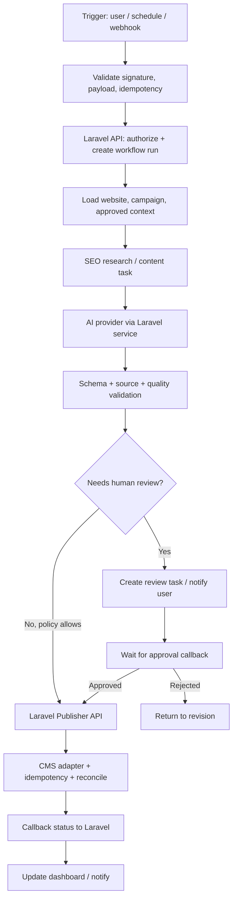

# KẾ HOẠCH XÂY DỰNG TRẢI NGHIỆM NGƯỜI DÙNG AUTO-SEO

> Phiên bản 1.0 — 06/11/2026. Tài liệu dành cho Product/UX (người dùng phụ trách nghiệp vụ, logic và giao diện), Dev1 (backend/core) và Dev2 (Filament/AI theo `AGENTS.md`).

## 1. Mục tiêu

Xây dựng giao diện đủ trực quan để một người chưa biết dự án có thể đăng nhập demo, hiểu hệ thống giải quyết việc gì, thấy các module, biết quy trình sử dụng và phân biệt được tính năng đã chạy với tính năng đang phát triển.

Không làm UI chỉ để “đẹp”. Mỗi màn hình phải trả lời được:

- Người dùng đang ở bước nào?
- Cần nhập dữ liệu gì và lấy ở đâu?
- Hệ thống sẽ làm gì tiếp theo?
- Kết quả sẽ xuất hiện ở đâu?
- Bước nào cần người dùng kiểm tra/phê duyệt?
- Tính năng đã hoạt động thật, mới có giao diện, hay đang chờ tích hợp?

## 2. Nguyên tắc sản phẩm và thiết kế

1. **Workflow-first:** điều hướng theo công việc người dùng: thiết lập website → hiểu website/SEO → lập kế hoạch → tạo nội dung → duyệt → xuất bản → đo lường.
2. **Progressive disclosure:** mặc định chỉ hiển thị thông tin cần để ra quyết định; cấu hình kỹ thuật, credential và chi tiết nâng cao nằm ở phần riêng.
3. **Một nguồn sự thật:** dữ liệu nghiệp vụ, quyền, trạng thái và xuất bản do Laravel/backend quản lý. n8n chỉ điều phối workflow tích hợp được cấp quyền; không ghi DB trực tiếp hoặc bỏ qua policy.
4. **Honest status:** mọi màn hình dùng nhãn rõ `Đang hoạt động`, `Có giao diện / chưa tích hợp`, `Theo kế hoạch`, `Chưa cấu hình`, `Lỗi`.
5. **Demo có kịch bản:** dữ liệu demo phải đánh dấu rõ; không trộn với website, bài viết, credential hoặc publication thật.
6. **Human-in-the-loop:** AI đề xuất/sinh bản nháp; con người duyệt trước khi publish, trừ khi có policy tự động được phê duyệt riêng.
7. **Không phá hợp đồng backend:** UI làm việc qua model/service/contract đã thống nhất; không tự thêm cột DB, sửa publisher, queue, migration hoặc credential flow của Dev1.
8. **Responsive và tiếng Việt:** ưu tiên desktop cho vận hành nhiều dữ liệu, nhưng form, trạng thái và thao tác chính phải dùng được trên tablet/mobile.

## 3. Đối tượng và hành trình

| Đối tượng | Việc cần hoàn thành | Màn hình chính |
|---|---|---|
| Quản trị hệ thống | Quản lý người dùng, website, quyền và cấu hình tích hợp | Tổng quan, Website kết nối, Cấu hình |
| Marketing/SEO | Tìm cơ hội, lập kế hoạch, tạo và tối ưu nội dung | SEO Audit, Từ khóa, Kế hoạch nội dung, Chiến dịch |
| Content editor | Kiểm tra brief, sửa bài, xem nguồn và chất lượng | Chi tiết bài, Editor, Quality report |
| Người duyệt | Xem thay đổi, kiểm chứng claim, duyệt/từ chối | Hàng chờ duyệt |
| Vận hành | Theo dõi lịch, lỗi, retry và đối soát | Lịch xuất bản, Nhật ký workflow |
| Quản lý | Đánh giá năng suất, chi phí và kết quả SEO | Báo cáo, AI usage, GSC |

Luồng cốt lõi:

`Thiết lập website → nhập bối cảnh doanh nghiệp → audit/keyword → kế hoạch nội dung → brief → AI tạo bản nháp → quality check → người duyệt → CMS draft/publish → đọc lại trạng thái → đo lường`.

## 4. Bản đồ màn hình theo giai đoạn

### Giai đoạn 0 — Demo và định hướng sản phẩm (làm trước)

| Màn hình | Nội dung cần thấy | Trạng thái hiện tại |
|---|---|---|
| Giới thiệu hệ thống / Product tour | Mô tả giá trị sản phẩm, các module, số liệu thực, bước bắt đầu, sơ đồ workflow | **Đang làm mẫu** |
| Dashboard vận hành | KPI, chiến dịch đang chạy, hàng chờ duyệt, lịch và cảnh báo theo vai trò | Theo đợt W5 trong `DEV2_UI_REDESIGN_PLAN.md`; không thay thế bằng trang giới thiệu |
| Hướng dẫn sử dụng | Checklist thiết lập, giải thích thuật ngữ, dữ liệu cần chuẩn bị | Cải thiện đề xuất |
| Workflow/n8n overview | Sơ đồ trigger → validate → Laravel → AI → review → publish → callback; nhãn rõ bước nào đã nối | Thiết kế tham chiếu; chưa có bằng chứng n8n đã tích hợp |

**Kết quả:** người ngoài có thể xem demo và hiểu hệ thống mà không cần giải thích miệng từng menu.

### Giai đoạn 1 — Thiết lập website (liên hệ task 0.5 và 1.2/1.4)

- Danh sách website dạng card/table: tên, CMS, domain, trạng thái kết nối, lần kiểm tra gần nhất.
- Wizard 3 bước: (1) thông tin website, (2) loại CMS và phạm vi, (3) credential + kiểm tra kết nối.
- Credential nhập theo trường phù hợp từng CMS, không dùng giao diện key-value khó hiểu; secret luôn che, không hiển thị lại sau khi lưu.
- Có nút “Kiểm tra kết nối” chỉ khi backend cung cấp API/service thật; không giả lập thành công.
- Trạng thái: Chưa cấu hình / Chờ kiểm tra / Đang hoạt động / Lỗi / Đã thu hồi.
- Hướng dẫn chuẩn bị WordPress Application Password hoặc Magento API/OAuth; hiển thị đúng yêu cầu theo connector.

### Giai đoạn 2 — Sản xuất và duyệt nội dung (0.5, 3.1, 3.4, 3.5)

- Campaign setup: website, mục tiêu, số bài, chủ đề, từ khóa, lịch và tài liệu nguồn.
- Article workspace: brief, outline, nội dung, SEO title/meta, ảnh, nguồn trích dẫn và version history.
- Editor tập trung vào nội dung; metadata và thông tin SEO ở panel phụ; không bắt người dùng nhập trường kỹ thuật không cần thiết.
- Quality panel: từng rule, mức độ, bằng chứng, cách khắc phục; nút duyệt bị khóa khi có lỗi chặn.
- Review inbox: lọc theo website, người viết, ngày, trạng thái; diff giữa các phiên bản; duyệt/từ chối kèm lý do.

### Giai đoạn 3 — SEO Intelligence (1.1, 1.3, 2.1, 2.2)

- Audit overview: điểm/tình trạng chỉ khi đủ dữ liệu; nhóm lỗi P0/P1/P2, URL bị ảnh hưởng và bằng chứng.
- Keyword workspace: import CSV, preview, kiểm tra trùng, intent, cluster; cho phép sửa/merge/split trước khi lưu.
- Content plan: calendar/kanban, topic cluster, keyword, intent, priority, target URL, owner, ngày dự kiến.
- Mọi volume/KD/CTR phải có nguồn và thời điểm; thiếu dữ liệu hiển thị “Chưa có dữ liệu”, không hiển thị số 0 giả.

### Giai đoạn 4 — Publishing và automation (1.2, 1.4, 3.2, 3.6)

- Lịch xuất bản theo múi giờ Việt Nam; lọc website, trạng thái và chiến dịch.
- Timeline mỗi publication: queued → publishing → published/failed/needs_reconcile.
- Chi tiết lỗi có mã, hành động an toàn tiếp theo và lịch sử đối soát; không có nút retry mù với POST tạo bài.
- Workflow monitor hiển thị correlation ID, node/run, thời gian, kết quả và log đã che secret.
- Nút dừng khẩn cấp chỉ xuất hiện khi backend cung cấp kill switch thật.

### Giai đoạn 5 — Đo lường và tối ưu (5.1–5.4, 6.1)

- GSC dashboard: clicks, impressions, CTR, position; filter page/query/device/country và so sánh kỳ.
- Content performance: bài tăng/giảm, cơ hội refresh, cannibalization, internal link.
- Competitor gap: chủ đề, URL đối thủ, bằng chứng, độ bao phủ của website mình.
- Recommendations tạo thành task có người phụ trách và trạng thái; không tự sửa nội dung live.

## 5. Thiết kế pipeline n8n — đề xuất, chưa khẳng định đã tích hợp

### 5.1 Phân định trách nhiệm

**Laravel là system of record và policy boundary:** xác thực user/service, kiểm tra quyền website, lưu dữ liệu, quản lý ArticleVersion, quality gate, credential, publication key, CMS adapter và đối soát.

**n8n là workflow orchestrator:** nhận trigger được ký/xác thực, gọi API Laravel, kết nối dịch vụ ngoài được allowlist, điều phối thông báo và trả trạng thái/correlation ID. n8n không truy cập DB Laravel trực tiếp, không lưu credential trùng nếu có thể dùng credential store được quản trị, không tự gọi CMS publish bỏ qua Laravel.

### 5.2 Workflow đề xuất

### 5.3 Quy ước kỹ thuật n8n

- Mỗi workflow có tên/version, owner, purpose, trigger, input/output schema, timeout, retry, error path và tài liệu.
- Mỗi execution truyền `correlation_id`, `website_id`, `campaign_id`, `task_id`; không truyền secret thô trong payload.
- Webhook cần HMAC/signature hoặc service token, timestamp, replay protection, rate limit và allowlist.
- Retry chỉ áp dụng thao tác idempotent hoặc GET; POST publish phải theo publication key và quy tắc `needs_reconcile` của Laravel.
- Lỗi có nhánh riêng: validation, auth, provider, quality, CMS, timeout; không gom tất cả thành “failed”.
- n8n không được coi HTTP 200 là publish thành công; phải chờ kết quả read-back từ Laravel/CMS adapter.
- Dev1 duyệt API contract, auth, webhook và publication boundary trước khi bật workflow thật.

### 5.4 Các workflow n8n nên tách nhỏ

| Workflow | Trigger | Nhiệm vụ | Tình trạng |
|---|---|---|---|
| `WF-01 Campaign Intake` | User tạo campaign | Validate input, tạo campaign run | Đề xuất |
| `WF-02 SEO Research` | Campaign được duyệt | Điều phối audit/keyword/competitor qua Laravel services | Đề xuất |
| `WF-03 Content Production` | Content plan item đến hạn | Tạo brief/draft, chạy quality, đưa vào review | Đề xuất |
| `WF-04 Approval & Publishing` | User duyệt | Gọi Laravel publisher, nhận trạng thái reconcile | Đề xuất |
| `WF-05 Monitoring & Alert` | Webhook/schedule | Theo dõi run, thông báo lỗi và chi phí | Đề xuất |
| `WF-06 GSC Reporting` | Lịch định kỳ | Đồng bộ/đọc báo cáo và tạo insight | Đề xuất |

## 6. Phân định việc của Product/UX và Dev1/Dev2

| Hạng mục | Product/UX (người dùng) | Dev1 | Dev2 |
|---|---|---|---|
| Product map, user journey, wireframe, nội dung UI | Chủ trì | Review khả thi | Review UX/Filament |
| Business rules, status, acceptance criteria | Chủ trì | Chốt backend contracts | Ánh xạ UI/validation |
| Filament resources/pages/widgets | Định hướng, review | Review khi ảnh hưởng core | Chủ trì code |
| Database, migrations, API, auth/policy | Đưa yêu cầu nghiệp vụ | Chủ trì | Không tự sửa |
| CMS connectors, queue, scheduler, reconcile | Mô tả tình huống sử dụng | Chủ trì | QA theo AC |
| n8n workflow definition | Mô tả trigger/nhánh/đầu ra | Duyệt API/security boundary | Xây trải nghiệm điều khiển/monitor nếu thuộc UI |
| QA người dùng | Viết kịch bản và nghiệm thu | Cung cấp staging/evidence | Sửa UI và hỗ trợ test |

## 7. Cách làm việc theo từng màn hình

Với mỗi màn hình, hoàn thành theo thứ tự:

1. **Problem statement:** ai dùng, đang gặp khó khăn gì, mục tiêu màn hình.
2. **User flow:** điểm vào, hành động, trạng thái thành công/thất bại/empty/loading.
3. **Wireframe:** cấu trúc, hierarchy, CTA chính/phụ, responsive.
4. **Business rules:** field, validation, permissions, state transitions, edge cases.
5. **Data contract:** field nào đã có, field nào cần Dev1 bổ sung; không tự tạo schema.
6. **UI implementation:** Filament page/resource/widget và nội dung tiếng Việt.
7. **QA:** desktop/mobile, role permission, empty/error/loading, dữ liệu thật vs demo.
8. **Handoff:** ảnh chụp, acceptance criteria, API/contract gap, câu hỏi cho Dev1.

## 8. Kế hoạch 10 lát cắt ưu tiên

| Thứ tự | Lát cắt | Phân loại | Đầu ra |
|---:|---|---|---|
| 1 | Dashboard giới thiệu sản phẩm + trạng thái thực | Cải thiện UX trên nền Filament hiện có | Người ngoài hiểu sản phẩm, module và luồng tổng thể |
| 2 | Website list + onboarding wizard | Kế hoạch gốc 0.5, cải thiện cách trình bày | Thêm website và hiểu cách kết nối |
| 3 | Campaign setup wizard | Kế hoạch gốc 3.4, cải thiện UX | Tạo chiến dịch theo mục tiêu/quota/nguồn |
| 4 | Article workspace/editor | Kế hoạch gốc 3.4 | Viết/sửa bài, version, SEO metadata, sources |
| 5 | Review inbox + quality panel | Kế hoạch gốc 3.4/3.5 | Duyệt có bằng chứng và lý do |
| 6 | SEO audit dashboard | Kế hoạch gốc 1.3 | Nhìn lỗi, URL và ưu tiên sửa |
| 7 | Keyword & cluster workspace | Kế hoạch gốc 2.1 | Import, cluster, chỉnh sửa và lưu |
| 8 | Content calendar/plan | Kế hoạch gốc 2.2 | Kéo thả, quota, trạng thái và owner |
| 9 | Workflow/n8n monitor | Cải thiện đề xuất | Hiểu execution, node lỗi, callback, retry an toàn |
| 10 | GSC/performance dashboard | Kế hoạch gốc 5.1–5.4 | Theo dõi kết quả và cơ hội tối ưu |

## 9. Phạm vi thử nghiệm đầu tiên

Thử nghiệm đầu tiên là trang **Giới thiệu hệ thống** (Product tour), tách khỏi Dashboard vận hành đã được lên lịch ở đợt W5 trong `DEV2_UI_REDESIGN_PLAN.md`:

- Giới thiệu Auto-SEO bằng ngôn ngữ Marketing, không dùng dashboard mặc định chỉ có thông tin framework.
- Có lối tắt tới Website, Bài viết, Thư viện ảnh và Lịch xuất bản hiện có.
- Số lượng website/bài/publication lấy từ database, không hardcode.
- Có pipeline tổng quan và ghi rõ workflow n8n `SEO web` hiện chưa có node được cấu hình; sơ đồ trên trang chỉ là kiến trúc tham chiếu.
- Không tạo dữ liệu mẫu, không sửa backend/DB, không thay đổi trạng thái WBS.

**Điều kiện đạt:** code đúng phạm vi Filament, không lộ secret, link điều hướng đúng, số liệu query đúng, giao diện responsive; kiểm thử PHP/Filament và browser khi môi trường có runtime.

## 10. Definition of Done cho bản demo

- [ ] Người mới hiểu sản phẩm trong 60 giây.
- [ ] Mỗi module có mô tả mục đích, đầu vào, đầu ra và trạng thái phát triển.
- [ ] Không có nút giả hoặc thông báo thành công giả.
- [ ] Không hiển thị credential/token/log nhạy cảm.
- [ ] Empty/loading/error state có nội dung hướng dẫn.
- [ ] Responsive và tiếng Việt nhất quán.
- [ ] Mọi tính năng chưa tích hợp có nhãn rõ.
- [ ] Các điểm cần API/DB được ghi thành contract gap để Dev1 quyết định.
- [ ] Có ảnh chụp và checklist nghiệm thu từng màn hình.
